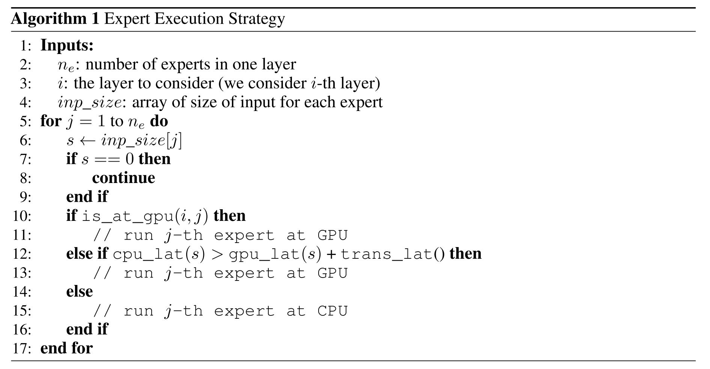
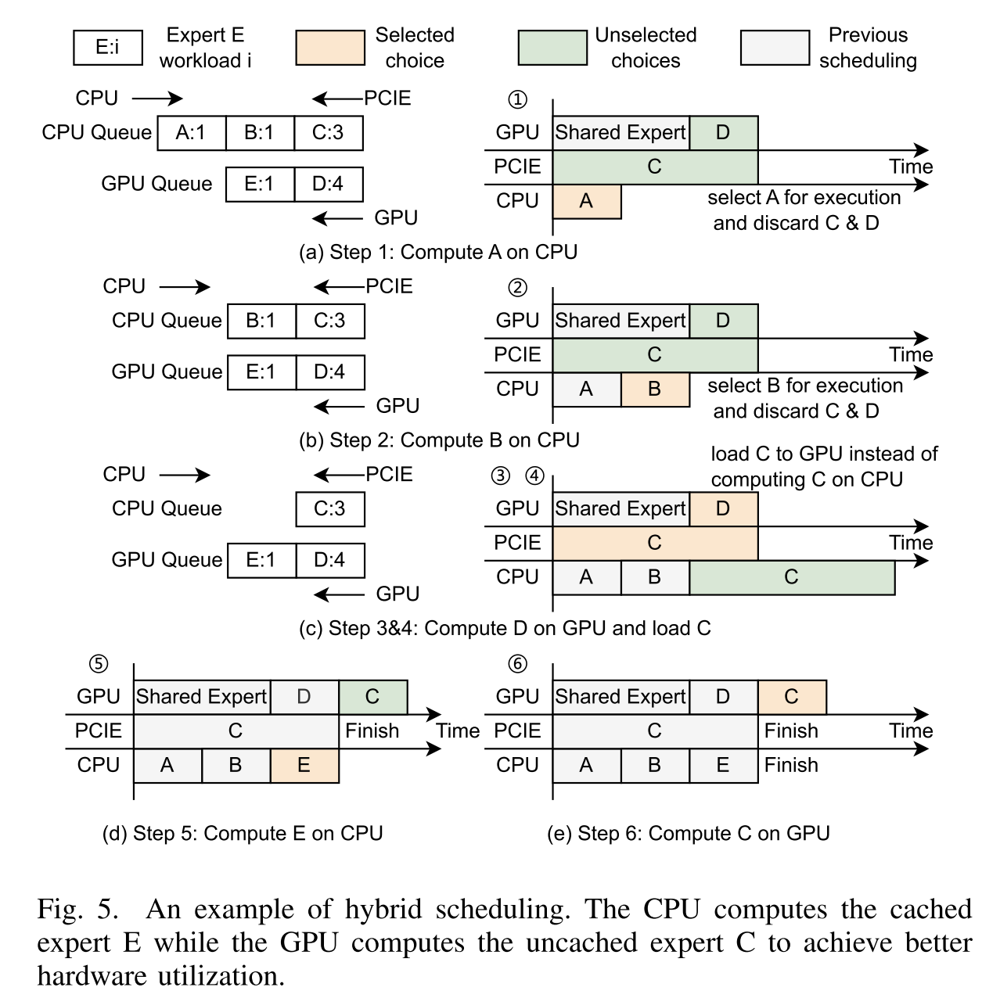
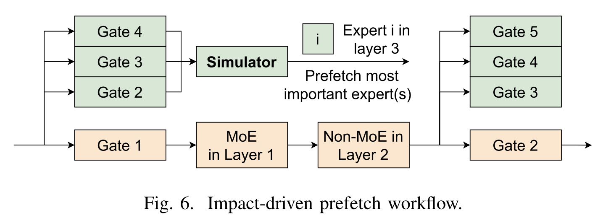
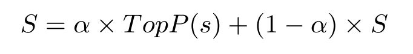

# 找论文

## Fiddler

latency model：对于较小的输入大小，在CPU上执行专家层更有效，避免了权重转移的开销。然而，对于更大的输入大小和批处理大小，CPU计算变得太耗时，从而使将权重传输到GPU内存并在GPU上执行计算更高效。

优化：

* 为了最大限度地提高所需专家在GPU内存中可用的可能性，我们基于专家population的离线分析，将常用专家放置在GPU上。
* 此外，我们使用AVX512_BF16指令集在CPU上设计了一个专门的计算内核，用于expert processing，这在本地PyTorch实现中不受支持(Paszke等人，2019年)。

Contribution:

* We design Fiddler, an inference system for MoE models running on resource-constrained heterogeneous architectures, which finds the optimal execution strategy using both the GPU and the CPU.
* We evaluate Fiddler and show that it achieves better performance in single batch inference, long prefill processing, and beam search inference, compared to different state-of-the-art systems each. It shows that Fiddler integrates the advantages of different types of existing systems.

design: 

* GPU processing exhibits a relatively stable latency across varying input sizes, which can be attributed to its parallel processing capabilities.
* In contrast, the latency associated with CPU processing tends to scale almost linearly with the input size

两种策略：

* 在CPU上直接做，需要把激活结果掉回GPU（时间可忽略不计）
* 或者把专家从CPU调到GPU上在GPU上做

(c) is advantageous when the input size to an expert is small, while (b) is better if the input size is above some threshold, even with large communication overhead.

Consequently, the transfer latency for activation is negligible when (c) is employed.

We determine the popular experts based on the profile of expert selection using calibration data.

Algorithm1: 

* is_at_gpu(i,j): 第i层的第j个expert是否在GPU上
* cpu_lat(s), gpu_lat(s): 给定大小为s的input size，在CPU/GPU上的预期执行时间
* transfer_lat(): 把一个expert的参数从CPU迁移到GPU的时间

optimizations:

离线评估：it selects as many experts as the memory capacity permits to maximize the hit rate, i.e., the likelihood an expert’s weight is in GPU memory.

We assume this method is enough as the expert selection is known to be based on token characteristics, and the popularity of experts is almost universal across different input domains.

## kTransformers

MoE十分适合用于hybrid CPU/GPU推理，尤其是低并发场景。

过去该方法的瓶颈：

* 在prefill阶段，没有充分利用CPU计算能力，全都是用的老的SIMD指令集，没能拓展到新的Intel AMX or ARM SME
* 在decode阶段，低效的CPU-GPU调度
  * CPU / GPU kernel启动时间过长，加剧同步开销
    * 过去的CUDA图：per layer，per batch size，都用各自的CUDA Graph
  * misaligned CPU memory accesses and expensive cross-NUMA data transfer，降低了系统吞吐

kTransformer的改进：

* Optimized AMX-specialized kernel：充分发挥CPU的计算能力
  * 对 prefill 阶段的 high-ARI tasks：使用Intel AMX指令集，specialized memory layout co-designed with AMX tiling
  * 对 decode 阶段的 low-ARI tasks：使用lighter AVX-512 kernels
  * CPU NUMA-aware tensor placement strategy：支持NUMA的TP
* 异步的CPU-GPU调度：减小开销，加快prefill和decode速度
  * 在整个decode阶段，都只用同一张CUDA Graph，取消CUDA launch overhead
* Expert Deferral mechanism：覆盖CPU和GPU计算，提高CPU利用率
  * 重组执行流水线，只有部分的experts会被立即处理，剩余的experts会和后续的attention同时处理。

design:

* Unleashing the Full Potential of the CPU

  * AMX Tiling-aware Memory Layout

  * Cache-Friendly AMX Kernels

  * Adaptive AVX-512 Kernel for Low ARI Scenarios
  * Fused MoE Operator

* CPU-GPU/CPU Coordination
  * Asynchronous CPU-GPU Task Scheduling Mechanism
    * a naive design必须在每个MoE层同步两次，一次是在GPU将激活发送到CPU时(submit)，另一次是在CPU返回其结果时(sync)。这些障碍打破了CUDA图，增加了内核启动开销。KTransformers将submit和sync都封装在cudaLaunchHostFunc中，这允许CUDA在当前stream中调用callback。一个token的整个decode phase都会在一张CUDA Graph中完成，消除了 host interruptions，提高decode速度。
  * NUMA-aware Tensor Parallelism
    * 支持非一致性内存访问（NUMA）的TP。过去在NUMA架构下的方法：传统大模型部署通常采用EP，频繁触发跨 socket 的远程内存访问，而且这种方式在单机多 socket 场景中容易造成负载不均。KTransformers的方法：做TP，对每个 expert 的权重矩阵进行跨 socket 的张量切分。避免几乎所有远程 NUMA 内存访问，在 socket 之间实现更好的负载均衡。

* CPU-GPU Overlap
  * Expert Deferral：过去的方法，CPU必须等GPU。
  * Determining the Number of Deferred Experts

## HybriMoE

过去的方法：在MOE模型的上下文中，像Fiddler和kTransformers这样的技术通过在缓存未命中期间将专家层计算卸载到CPU。

challenges:

* Challenge 1: High Instability of MoE Activation Patterns
  * MOE模型具有不可预测的激活模式，并且在迭代中专家以动态且频繁变化的方式激活，导致现有工作固定的映射策略效率低下。
* Challenge 2: Complexity of MoE Structure and Dynamic Scheduling
  * 最小化MOE推理中的延迟需要最大化硬件利用率，但现有的固定映射方法经常导致负载不平衡和资源未得到充分利用。MOE模型的不同结构进一步增加了调度的复杂性，其中共享专家使用、专家大小和数量以及运行时缓存行为各不相同。此外，负载分配不均和prefill阶段的执行顺序可变使得高效调度更具挑战性。

一种混合CPU-GPU推理框架，该框架通过一种新颖的CPU-GPU调度和缓存管理系统来提高资源利用率。

现有的解决方案依赖于基于历史激活频率的固定映射策略，忽略了MOE推理的动态性和不可预测性。

这些限制导致资源利用率不佳和推理延迟增加。

技术：

* 动态层内调度策略：a dynamic intra-layer scheduling strategy to **balance workloads** across CPU and GPU
* 层间预取算法：an impact-driven inter-layer prefetching algorithm
* 迭代间基于分数的缓存算法：a score-based caching algorithm to mitigate expert activation instability

contributions:

* Hybrid MoE CPU-GPU Scheduling：一种高效的MOE推理混合调度算法，可在GPU和CPU之间动态平衡工作负载，通过按优先级执行任务和数据传输管理来优化资源利用率并最大限度地降低延迟。
* Impact-driven prefetching：一种预取机制，模拟从后续层预加载专家的潜在影响，并对预期收益较高的专家进行优先排序。
* MoE-specialized Cache Management：一种基于专家分数的缓存策略，跨层对高需求专家进行优先排序，以最大限度地减少缓存未命中。

System Implementation：我们在kTransformers框架的基础上实现了HybriMoE

### Hybrid Scheduling Strategy

Insight:

* 专家的传输时间接近恒定。
* GPU计算时间与激活的专家数量呈线性关系，而CPU计算因其更大的缓存而受益于重叠的内存访问和计算。
* 随着工作负载的增加，GPU时间保持稳定，而CPU时间随着工作负载线性增长。

通过引入三个关键的优先级规则来简化任务到硬件的映射：

* GPU Priority: GPU优先处理缓存专家的计算，首先执行负载较高的专家。
* CPU Priority: CPU优先处理未缓存的专家的计算，专注于负载较低的任务以实现高效执行。此外，当CPU空闲时，CPU可以按照从低到高的负载顺序处理缓存的专家。
* Transfer Priority: PCIe传输机制优先将高负载、未缓存的专家从CPU迁移到GPU，以最大限度地减少计算延迟。

根据这些优先级规则，hysiMoE将所有激活的专家划分为一个GPU队列（按负载降序排列）和一个CPU队列（按负载升序排列）。

**在实际执行之前**，模拟iteratively filling the CPU computation, GPU computation, and data transferring timelines，使系统能够确定最小化总体等待时间的调度配置，同时平衡跨异类硬件的资源利用。

在模拟的每个步骤中，系统选择完成时间最早的时间线并执行相应的操作-要么是在CPU或GPU上的计算任务，要么是通过PCIe的数据传输。任务选择遵循调度优先级：GPU优先处理高负载缓存专家，CPU专注于低负载未缓存专家，当其队列为空时，处理来自GPU队列的低负载缓存专家，而PCIe优先处理高负载未缓存专家，以便在GPU上更快地可用。

如果将专家从CPU转移到GPU，它将按负载降序插入到GPU队列中，从而确保高负载任务优先用于GPU计算。

### Impact-driven prefetching

MOE模型通常在相邻层之间表现出很高的激活相似性。

在执行预取之前，系统执行模拟以评估预取特定专家的潜在收益。该模拟估计了预加载给定专家对总体调度效率的影响，从而允许算法对产生最高资源利用率改进的专家进行优先排序。这种模拟的贪心性质确保了最小的计算开销，使其适用于实时推理场景。

具体来说，重用后三层的gating information，预测激活，从而指导prefetch machanism，实现预先加载expert。

### Score-aware Caching

缓解专家激活的不稳定性。

激活分数较高的专家更有可能在下一次迭代中被重用，这表明在缓存中保留高分数专家可以减少访问延迟。

传统上，MOE缓存管理使用最少使用(LFU)和最近最少使用(LRU)算法。然而，这些策略未能考虑到在MOE模型中观察到的特定激活模式。在MOE模型中，专家评分为未来的激活提供了有价值的预测信号。不仅当前激活的专家可能在未来被重复使用，而且得分高但没有激活的专家在随后的迭代中被选中的可能性也更高。

Minus Recent Score (MRS) replacement policy：根据专家的路由得分确定保留专家cache的顺序。

* s: 当前iteration中所有experts的routing score
* S: 估计的优先级分数
* $\alpha$: 平均系数

通常，我们将p设置为激活专家数量的两倍。

每一轮结束，做score-aware caching，决定哪些expert para保留在GPU；然后在实际做的过程中，一边做当前的实时调度，一边做prefetch（提前把当前在CPU而且需要调入GPU的调进来）。
