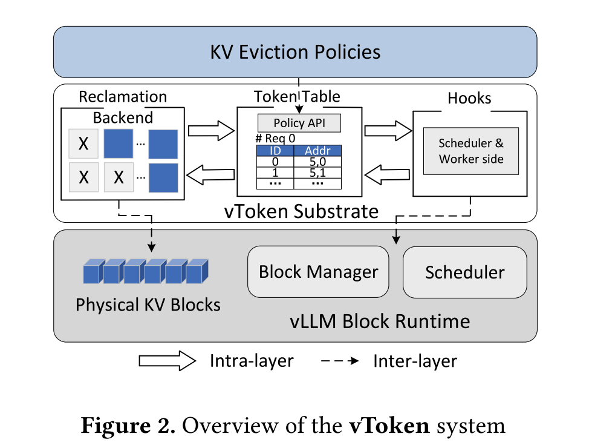
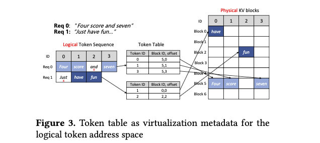
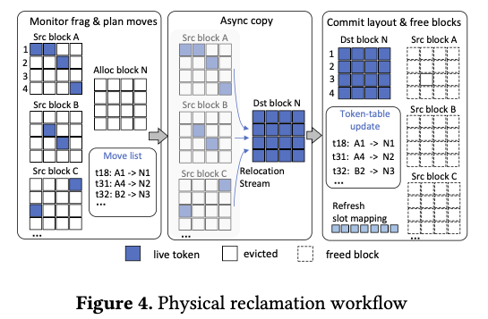
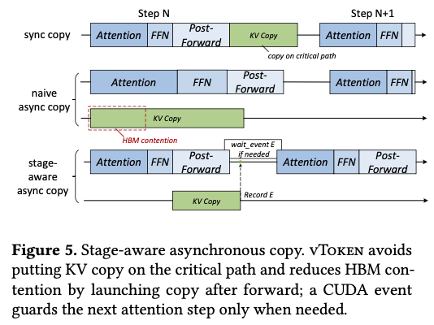

# vToken

问题：

Slot mapping是什么

step6-8后面细看

logical layout metadata is updated in the worker path after forward returns


insight：KV eviction 的粒度是 token级，PagedAttention分配/回收显存的粒度都是block级。驱逐token之后，physical block 仍然属于 Request A，不能被释放重新分配。这个granularity mismatch导致了块内碎片（intra-block fragmentation）。

vToken的解决方案：token-level virtualization layer，进一步把 “上层token语义” 和 “下层block管理” 分离。

* 向上，vToken 给 eviction policy 暴露 token-level interface。上层 policy 只负责保留 / 删除某个token。
* 向下：
  * logical-to-physical mapping
  * 刷新compact前后的 slot mapping
  * reclaims physical blocks by asynchronously repacking live tokens

## 3 vToken Design

### 3.1 Design Goals and Virtualization Boundary



* KV Eviction Policies
  * 它们的任务只有一个：决定哪些 logical token 还要保留，哪些可以删除。
  * 它不关心：token 应该在哪个physical block / slot、现在是否应该compact
* vToken Substrate
  * token table：
    * \[ \text{Logical Token ID} \rightarrow \text{Physical KV Address} \]
    * logical view：哪些 token alive/dead。
    * physical view：这个 logical token 当前具体放在哪个 physical KV slot。
  * Reclamation Backend：**lazy compaction，token dead != 立即释放其物理内存**
    * 选择 source / destination block；
    * batch live KV；
    * 发起 async copy；
    * compaction；
    * 最后让某些 physical block 彻底空出来。
  * Hooks：
    * 是 correctness 的关键，一旦 KV 的 physical slot 改了，下一次 attention 就必须使用新的 slot mapping。
    * **负责刷新 slot mapping**
    * **负责同步 async reclamation**，假设Reclamation Backend在另一个CUDA stream搬KV，那么Attention stream不能在此之前
* vLLM Block Runtime
  * Physical KV Blocks：GPU 显存里真正存储 K/V tensor 的位置，依旧是PagedAttention的block。
  * Block Manager： vLLM 原生组件，负责传统意义上的 block allocation / reclamation（block-level）。
  * Scheduler：vLLM 原生组件
    * 负责哪些 request 当前运行 / 哪些进入 batch / decode scheduling / prefill/decode 执行 / memory pressure 下哪些 sequence 继续。
    * vToken Hooks 会和它交互，因为 reclamation 的时机和当前 scheduling 状态有关。


执行流程：

* Step 1：Eviction Policy 做逻辑决策
* Step 2：Policy API 更新 Token Table
  * 此时 physical KV 不一定发生任何变化。
* Step 3：Backend 判断 fragmentation 是否 actionable
  * Backend 不会看到一个 dead token 就马上搬。
  * 检查是否达到threshold。
* Step 4：选择 source / destination
* Step 5：发起异步 KV copy
* Step 6：更新 Token Table
  * 但对上层 policy 来说，T8还是T8，T10还是T10，T13还是T13，这就是 virtualization 的价值。
* Step 7：Hooks 刷新 attention slot mapping
* Step 8：建立 CUDA dependency
* Step 9：Block Manager 回收完整 block


三个challenge:

* logical token 和 physical block 怎么同时保持一致 (3.2)
* 搬 KV 时怎么保证 attention 不读错 (3.3)
  * \(\text{KV Copy} \rightarrow \text{Mapping Refresh} \rightarrow \text{Attention}\)
  * 不能cudaDeviceSynchronize()，而是CUDA-event dependency
* 怎么让开销低、policy 无关 (3.4)

  

### 3.2 Token Table and Logical Address Space



左侧Token ID，右侧Block id + offset、liveness。

逻辑的`evict_token()` 并不等价于物理 `free()`，只需要修改token table。

对外暴露三个API：

* evict_token(req_id, token_id)：它只做 \(\text{liveness}=0\)。
* sync_new_tokens(req_id, block_ids, total_len)： decode 新生成一个 token，block manager 已经把它写到显存的对应位置，Token Table 就新增一行 T4 → (Block8, offset0), live。
* apply_moves(req_id, moves)：作为reclamation backend 使用的内部接口，假设Backend 做了一次 relocation，实际 GPU copy 完成后，然后 Backend 调用apply_move，Token Table 更新Block id + offset。

canonical table 放 CPU

a GPU-resident lookup cache accelerates slot translation in the steady-state decoding path.

这里看原论文...

### 3.3 Physical Reclamation: A Backend for the Virtualization Boundary

1. Reclamation eligibility：判断现在是否值得整理？
   
2. Headroom-aware admission：判断现在有没有足够临时空间来搬？
   
3. Relocation planning：决定哪些 live token 从哪里搬到哪里？
   
4. Asynchronous copy：真正执行 KV copy



lazy compaction：不是每次出现 dead token 就立刻整理，而是先允许碎片存在，等满足某种条件后，再集中整理。

repacks retained tokens from low-utilization blocks：把 retained/live tokens 搬出来，最后 source blocks 变空，直接回收。

Move list：每一项描述 \(\text{logical token ID} : \text{old physical slot} \rightarrow \text{new physical slot}\)。

updates the token table after copies complete, returns emptied blocks to the allocator

stable logical token view while physical KV locations change underneath

#### 3.3.1 Reclamation Eligibility

不去每次都扫描完整 Token Table，而是在每个 physical block 都维护一个计数\(n_b = \text{该 block 中仍然 live 的 token 数}\)，用它快速估算碎片程度。

增量维护intra-block waste ratio $F$：

每次evict token、sync_new_tokens、apply_moves都会实时更新 $F$。


两层降频：

* amortize checks over multiple scheduling iterations，每隔若干次迭代检查全局$F$，不是每个 iteration 都检查。
* rate-limit reclamation attempts：检查到F高，也不是无限频繁触发。

只有fragmentation真的likely actionable，才调用**planner**。

#### 3.3.2 Headroom-Aware Admission

当 free-block count is near a low watermark，开始优先考虑 reclamation。

vToken 尝试 reclamation 必须满足的三个条件：

* $F > \theta_{F} = 0.25$
  * 设置过低，频繁回收，开销过大；设置过高，平均碎片更多，显存利用率低
* 存在足够多的low-utilization blocks 
* $N_{\text{free}} \approx \text{low watermark}$（bounded evacuation headroom）

当free-block数量接近low watermark，暂缓/限制新request admission，不要让它们继续吃掉最后的free blocks，优先让reclamation使用这些blocks。

最后一个条件：plan 还必须真正“放得下”。必须planner算出来的$N_{\text{required\_destination}} < N_{headroom}$，否则这次先不compact，等后续某个request结束，一些blocks自然释放，headroom够了，再执行plan。

#### 3.3.3 Relocation Planning

为了符合原生 vLLM 的 block ownership 模型，一次 relocation planning 只在同一个 request 内部做 compaction。

第一步：选 low-utilization source blocks 

* 贪心选live token最少的blocks 
* 计算live token数量 $T_{\text{live}}$ 
* 参数reclamation batch size $B$表示一轮最多考虑多少个 source blocks。

第二步：算需要几个 Destination Blocks 

* $N_{\mathrm{dst}}=\left\lceil\frac{T_{\mathrm{live}}}{S}\right\rceil$
* 本次回收必须有收益：$N_{\mathrm{dst}} < N_{\mathrm{src}}$
*  Destination Blocks都来自bounded evacuation headroom
* 如果 Destination 不够，the planner reduces the candidate set and emits no relocation plan for that round

第三步：生成 Move List 

* 每个move有四层信息：(token ID, src_block, src_offset, dst_block, dst_offset)
* 按序填满destination blocks 0, 1,...（尽可能保留logical token order）

当KV copy完成之后，调用apply_move，更新token_table。

#### 3.3.4 Stage-Aware Asynchronous Copy



Post-forward包括 sampling、scheduling、下一步预处理，更多是 CPU-side work，GPU 利用率较低。

为了避免带宽竞争，在 post-forward 阶段进行 KV copy。

为了保证正确性，必须在current step's forward结束之后，再进行KV copy。

CUDA Event：当KV copy时间长于post-forward，形成正确性约束。

如果采用最粗暴的cudaDeviceSynchronize()，CPU 会launch copy、CPU停住等待、copy结束、CPU继续scheduler/preprocessing，这就把CPU post-forward work一起阻塞掉。而用stream.wait_event(E)，CPU 做的只是告诉GPU“下一次attention在event E之后执行”，然后 CPU 自己继续sampling、scheduling、preprocessing，所以CPU不等待copy。

什么时候才能 free source blocks？

必须等① KV copy完成、② 新layout成为有效layout、③ Token Table更新、④ slot mapping切换到新layout，之后旧 source blocks 才能真正回 free pool。

logical layout metadata is updated in the worker path after forward returns

没看懂，后面细看...

### 3.4 Integration with the Scheduler

结合vllm的scheduler，vLLM 原来的 Attention、Scheduler、CUDA Graph 怎么知道 KV 已经被 vToken 搬过了？

#### Slot mapping：Attention 怎么找到搬迁后的 KV？

根据token id查token table，找到block id和offset，然后算slot。

**Token Table lookup 不在 Attention kernel 里面：**

The lookup is performed once per token during input preparation rather than inside the attention kernel.

作者没有修改 PagedAttention kernel 让它自己查 Token Table，而且提前构造slot mapping（T0, T1,... -> slot21, 22,...）


不是：

```
Attention kernel
      ↓
我要读取T2
      ↓
查Token Table
      ↓
T2在哪？
      ↓
Block9 offset0
      ↓
读取KV
```

而是提前：

```
Input preparation
      ↓
查Token Table
      ↓
构造slot mapping

T0 → slot20
T1 → slot21
T2 → slot36
T3 → slot23
      ↓
Attention kernel
直接使用这些slot
```

如果每次 attention 访问 KV 都要额外查，token ID → Token Table → physical slot，那么kernel 要改、多一次 memory indirection、CUDA kernel 更复杂、可能破坏现有 PagedAttention 优化、TensorRT-LLM、SGLang 等移植也更困难。

而现在Token Table - 预先生成slot mapping - 原来的PagedAttention，因此作者才能一直强调attention kernels untouched，这也是 vToken 所谓“lightweight virtualization layer”的重要体现。

#### Scheduler hooks：vToken 怎么嵌进原来的 decode loop？

**Scheduler-side reservation hook**

这就是 3.3.2 的 Headroom-Aware Admission 真正在 scheduler 里的落点

```
Scheduler准备admit新request
          ↓
Reservation Hook
          ↓
检查free block / headroom
       ┌──┴──┐
       │     │
   足够宽裕   接近low watermark
       │     │
       ▼     ▼
    正常admit   backpressure
                 ↓
          优先留给reclamation
```

**Worker-side reclamation hook**

这个 Hook 基本就是把整个 3.3 的执行流程嵌进去。

它干三件事：

**① Evaluate**

看看：\[ F>\theta_F? \]

有没有 low-utilization blocks？有没有 profitable plan？

**② Launch async copy**

生成 Move List：

```
T18: A1 → N1
T31: A4 → N2
T32: B2 → N3
```

然后在：

```
Relocation Stream
```

上发起：

```
KV copy
```

**③ Rewrite logical layout metadata**

搬完之后更新：

```
Token Table

T18: A1 → N1
T31: A4 → N2
...
```

**Pre-attention synchronization**

第三个就是我们刚刚 Figure 5 讲的 CUDA Event。

建立 \[ \boxed{ KV\ Copy \rightarrow Attention_{N+1} } \] 的依赖关系。

#### CUDA Graph：KV 地址动态变化之后，为什么原来的 CUDA Graph 还能继续 replay？

CUDA Graph 的思想大致是第一次capture一串GPU操作，以后直接 replay graph，这样避免每个 decode step CPU 重复 launch 大量 CUDA kernels，降低 kernel launch overhead。

现在的问题：vToken 的 KV 地址一直在变，capture 时和后来reclamation时，同一个token的物理slot发生改变。那是不是Graph capture 时记住了旧地址，所以 graph 失效，需要 recapture？如果是这样，vToken 的代价会很大。

作者的答案是不需要。

KV cache tensor 和 CUDA Graph 捕获时使用的输入缓冲区地址都保持不变；在每次 graph replay 之前，只需要根据 Token Table 动态修改 slot mapping 来继续使用原来的 CUDA Graph，而不是绕开 CUDA Graph，或者每次 relocation 后重新 capture graph。

\(\boxed{\text{KV 的“位置”可以变，但 CUDA Graph 看到的 tensor/buffer 地址不变}}\)

### 3.5 Correctness Invariants

| Invariant                   | 核心问题                                       |
| --------------------------- | ---------------------------------------------- |
| I1 Token conservation       | **东西有没有搬丢/搬错？**                      |
| I2 Unique mapping           | **地址映射有没有冲突/重复？**                  |
| I3 Pre-attention visibility | **Attention 会不会在 copy 完之前就读新地址？** |
| I4 Layout-aware planning    | **Planner 会不会基于过期/冲突的状态乱搬？**    |

看原论文

