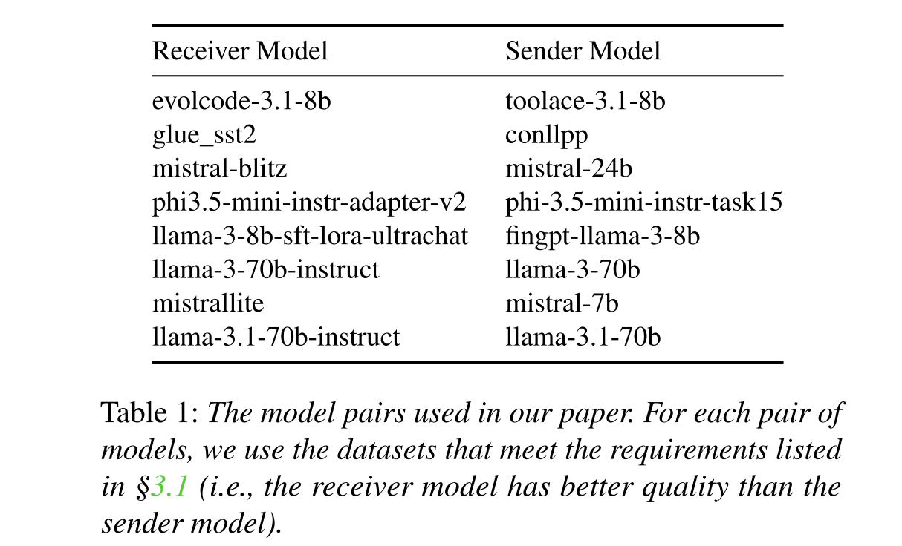
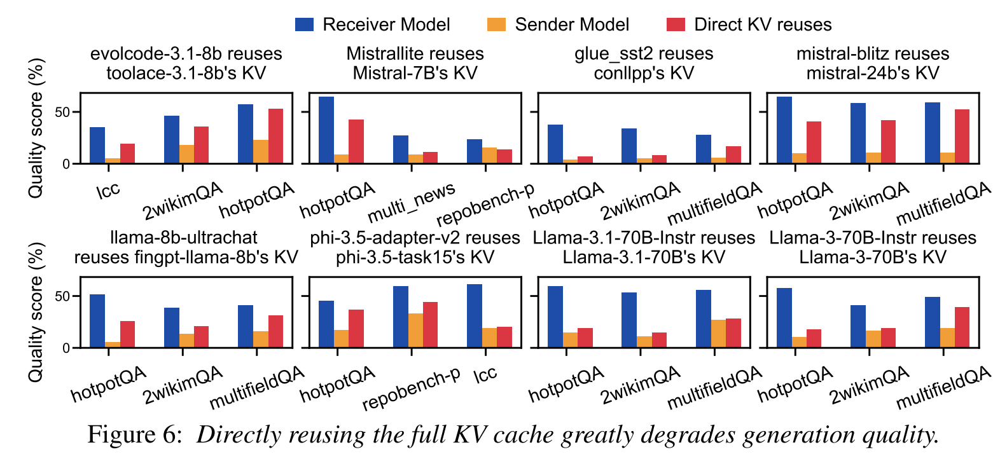
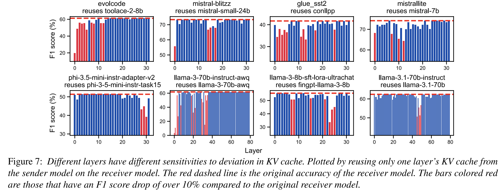
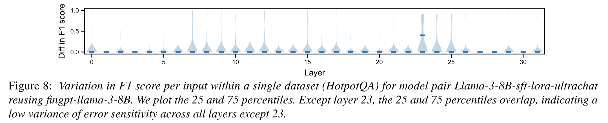
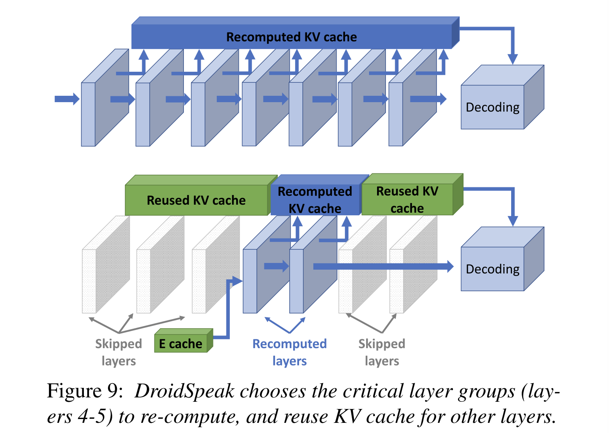
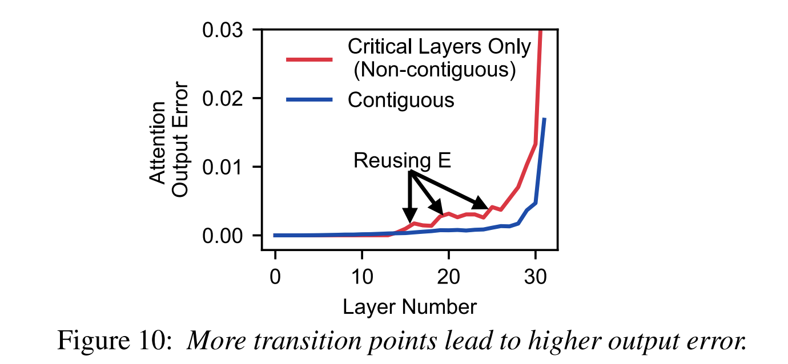
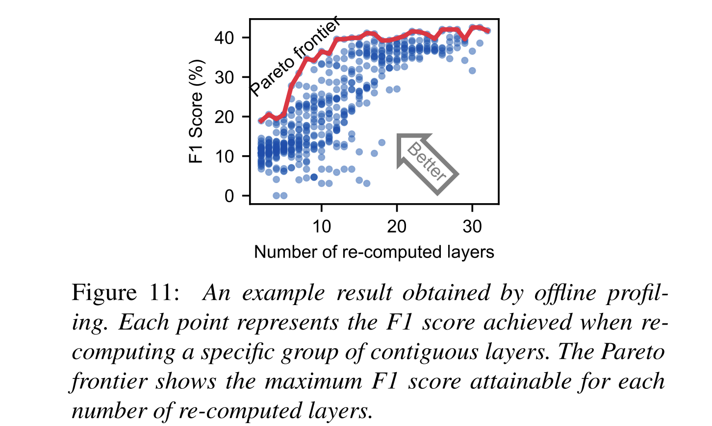
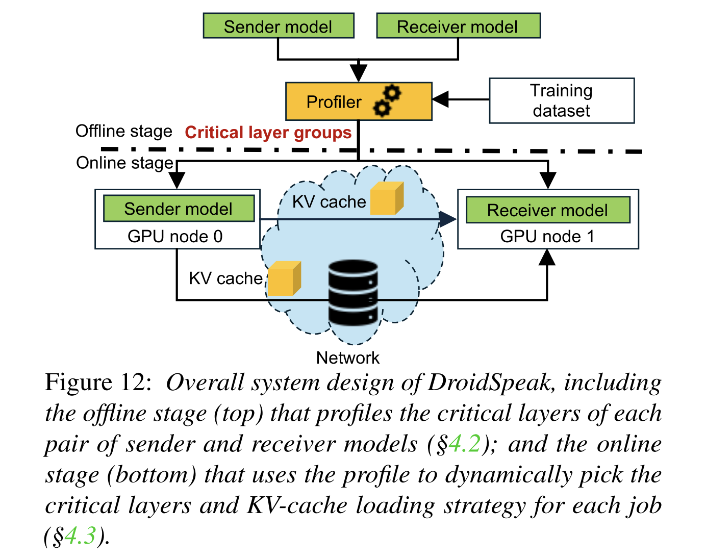
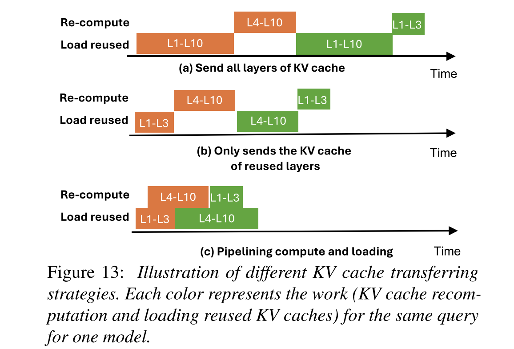

# DroidSpeak

emerging trend: hosting multiple different LLMs in one GPU cluster.

* multi-agent systems
* multi-LoRA or multiple fine-tuned models
* personalized assistant systems

在这些场景中，不同的LLM通常处理相同上下文前缀的输入。过去的很多工作都支持在单个模型的输入之间去做prefix caching，但如何使一个模型能够重用不同模型的prefix KV cache仍然是一个悬而未决的问题。

assumption: the two LLMs have different weights but the same architecture.

DroidSpeak: 只要LLM具备相同架构，就可以在运行LLM推理的分布式节点上，重用KV cache，加速其他LLM做prefill。

## 3 Reusing KV cache across LLMs

### 3.1 Building the benchmarks and datasets

benchmark set:

* The pair of models should share the same foundational model.
* The dataset selected should be related to the task for which one of the models has been fine-tuned.
* The receiver model fine-tuned on the task in the corresponding dataset should yield better quality than the sender model in the pair.

### 3.2 Empirical insights of KV cache

**Insight 1**: Reusing the whole KVcache between models leads to a huge loss in accuracy.

**Insight 2**: Only a small subset oflayers are sensitive to KV cache reuse in terms ofaccuracy.

**Insight 3**: The variation in KVcache patterns across inputs is only notable for critical layers.

## 4 DroidSpeak Design

### 4.1 Challenges with Selective KV Cache Reuse

selecting all critical layers scattered across different parts of the LLM is suboptimal for both efficiency and quality.

**The efficiency challenge**: Recomputing critical layers that are non-contiguously placed is inefficient.

当从KV cache重用切换到重新计算时，传输sender model的E cache进行重新计算。

E cache的大小通常是KV cache的2-4倍，在GPU之间的传输开销是巨大的。

**The accuracy challenge**：重用sender的E cache会影响receiver的final output精度。It is crucial to minimize the error caused by such deviation.

如果pick所有的这些不连续的critical layer，there will be multiple transition layers from reuse to recompute, introducing multiple deviations in E cache.

结论：re-computing a contiguous group of layers has much lower output error than only re-computing the critical layers.

### 4.2 Profiling for re-computation configuration

如何决定critical layer group？

基于Insight 3，先在example input上选择critical layer group，然后应用到其他new input。

Goal: understand the relationship between the critical layer groups to perform re-computation and its impact on generation quality.

找到specific critical layer groups的Pareto frontier（captures the highest F1 score）。

**Profiling Overhead**： $O(l^2)$。

This one-time cost is negligible since these models are deployed at a very large scale.

实际部署时可以用 2-layer group 粒度做 profiling，计算量减少约 3x，精度损失可以忽略。

### 4.3 DroidSpeak runtime design

DroidSpeak consists of two stages:

* offline stage: dynamically choose the right re-computation configuration
* online stage: DroidSpeak dynamically decides which point on the Pareto frontier should be used based on the latency SLO

**Smart KV Cache Loading**

* Model A: recomputes layers 4–10 and reuses KV cache for layers 1–3.
* Model B: recomputes layers 1–3 and reuses KV cache for layers 4–10.

三种loading和recompute策略：

* naive approach: 在开始重新计算之前加载所有层的KV cache。
* slight improvement: load only the reusable layers’ KV cache for A and B, right before recomputation.
* **pipelines loading and recomputation**: 先传 transition layer 的 E cache（体积小），立刻开始重算；同时在后台把复用 layer 的 KV Cache 加载进来。

### 4.4 Implementation

3K lines of code in Python, based on PyTorch v2.0, CUDA 12.0, and LMCache 0.1.4

* store(Cache, context, LLM)
* fetch(context, LLM, layer_id) -> KV/E Cache
* partial_prefill(recompute_config, context) -> text

在vLLM和LM-Cache中实现这三个接口。store用于sender产生新KV cache时的管理。在offline stage，先确定re-computation configuration。然后开始online inference，调用partial_prefill，其中包含用torch.distributed实现的fetch_kv和fetch_e。

## 5 Evaluation

