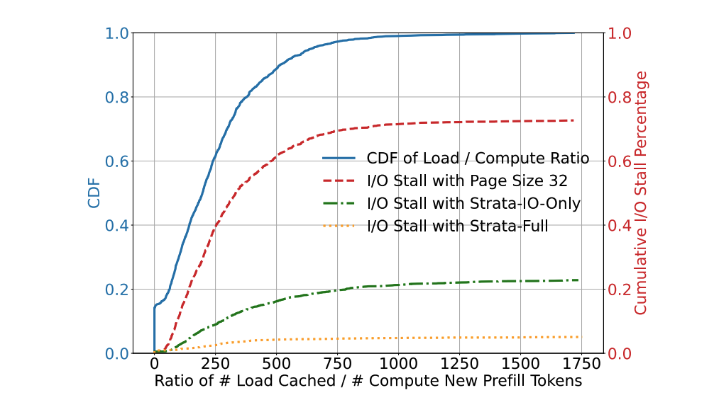
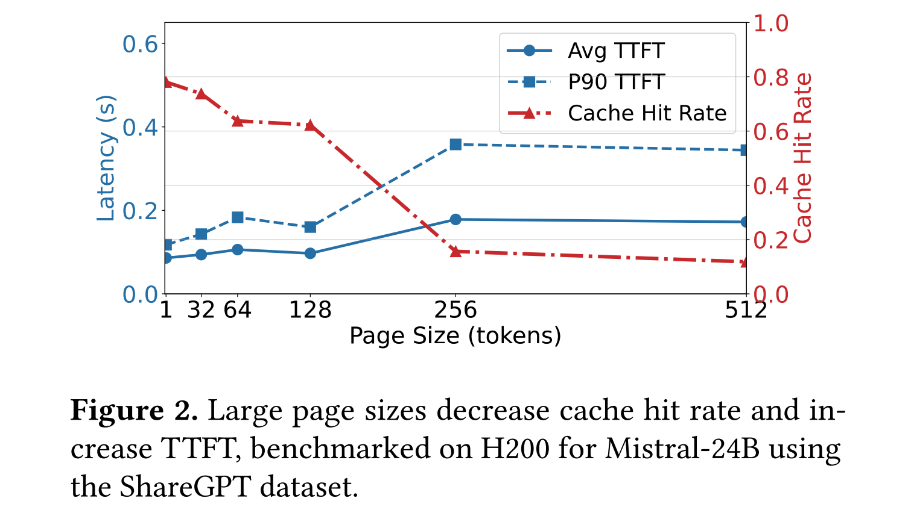
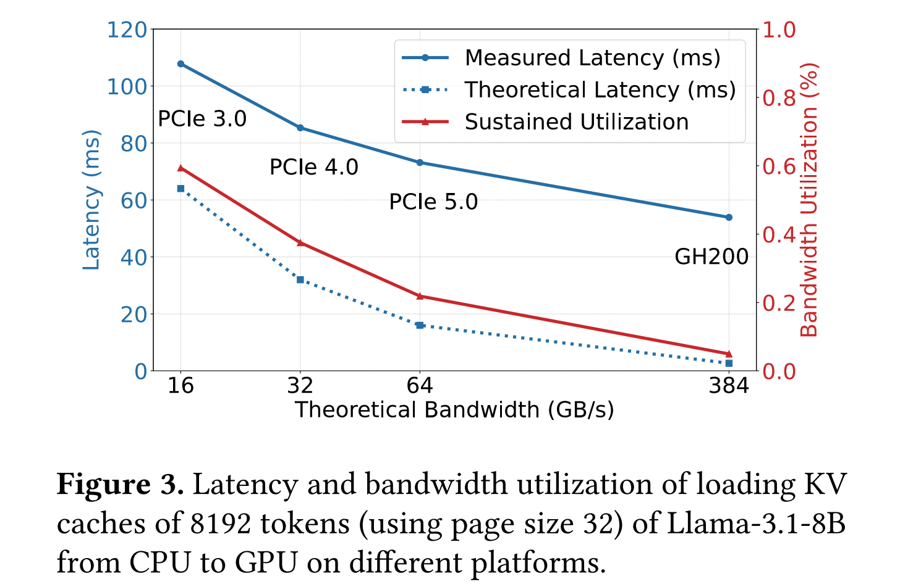
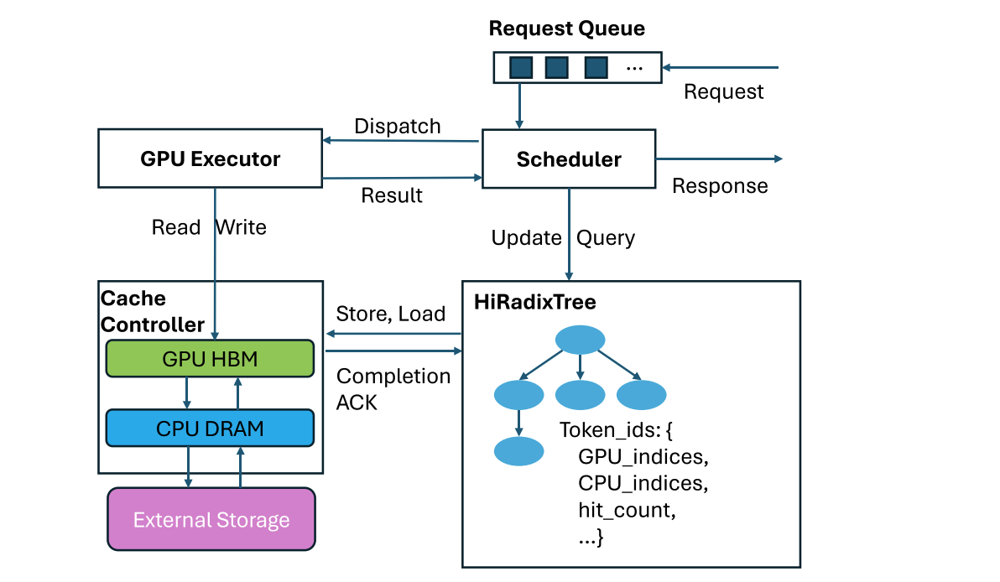
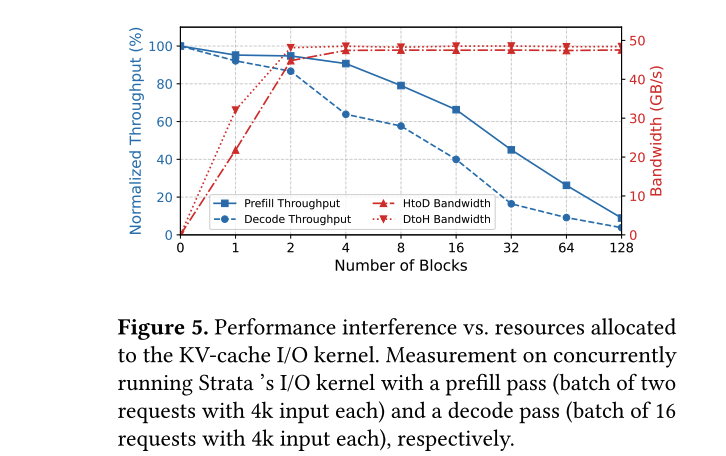
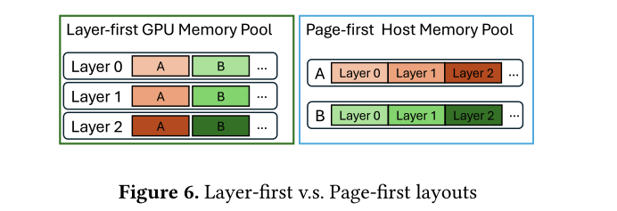
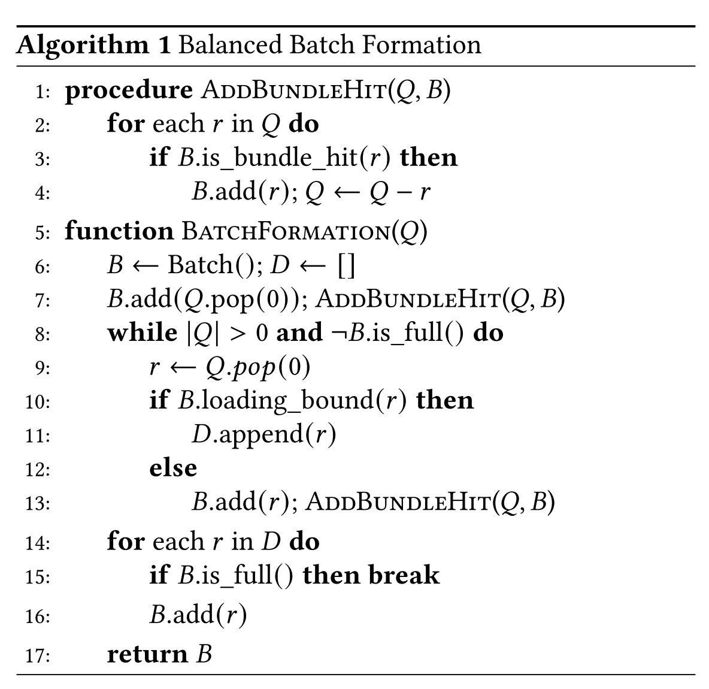
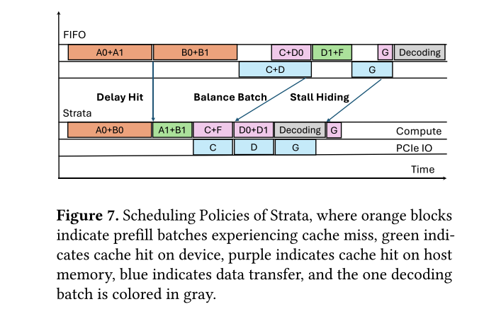

# Strata

Strata: Hierarchical Context Caching for Long Context Language Model Serving.

背景：长上下文的KV cache很快就超过了内存容量，迫使跨内存层次结构分层传输。

问题：将large cached context传输回GPU会带来严重的性能瓶颈。

* 分页布局的碎片化I/O阻止了充分利用带宽
* 现有的调度系统没有考虑cache-loading delays，即使优化了I/O依旧会有loading-bound的问题

结果：leaving systems loading-bound rather than compute-bound.

Strata:

* GPU-assisted I/O to combat KV cache fragmentation, decoupling GPU and CPU memory layouts
* employs cache-aware request scheduling to reduce long-context overheads
  * 构建balanced batches，以匹配足够的prefill computation来cover I/O latency。
  * 当cache loading stalls不可避免时，插入useful complementary tasks (e.g., decoding batches)，充分利用计算资源。

部署在SGLang上，长序列的TTFT相比vLLM + LMCache快5倍，相比NVIDIA TensorRT-LLM快3.75倍，而且短序列的性能未下降。

## 1 Introduction

Serving the LooGLE dataset with SGLang offloading KV caches to CPU memory, 74% of prefill time is blocked on KV transfers（图一红线）.

两个主要原因：

* PagedAttention为了节省GPU显存碎片，把每个请求的 KV 打散到多个不连续页，导致data fragmentation。读取时只能做到大量小尺寸传输，不能打满PCIe带宽。
* 现有scheduler假设“计算新 token 的时间足够长，能掩盖加载旧 KV 的延迟”。但长上下文下，加载时间比计算时间还长，导致 GPU 干等着数据，调度策略完全失效（图一绿线仍有$24\%$停顿）。

## 2 Background

### 2.2 Memory Management of KV Cache

Typical page sizes are small—e.g., 32, 16, and 1 tokens in TensorRT-LLM, vLLM, and SGLang.

这种细粒度的内存管理，对跨内存层的数据移动带来了严重的效率挑战。

### 2.3 Context Caching in LLM Serving

在requests之间使用前缀缓存加速prefill。

Recent systems逐层地overlap cache loading和computation来最小化延迟，同时异步地把新的KV cache备份到低层。

## 3 Challenges of Long Context Caching

### 3.1 Low Bandwidth Utilization in KV Cache Transfers
吞吐量$X = C \times \frac{S}{L}$，其中$C$表示平均并发执行的 I/O 操作数，$S$表示每次 I/O 操作的平均数据大小，$L$表示单次传输的耗时。

异步传输的常见做法：使用CUDA 提供的异步内存拷贝 API **cudaMemcpyAsync**。

PCIe 5.0 的理论带宽很高（约 32 GB/s 单向），但实测要跑到 75%~80% 的利用率，每次传输必须达到 1~2 MB。

- 如果每次只传几 KB，有效带宽可能连 10% 都不到。
- 这个数字直接给了设计目标：Strata 必须把 KV 传输粒度做到 MB 级别。

Howerver, LLM inference systems favor small granularity:

* 使用1-32 tokens的小页面，内存命中率和利用率都更高，但远没打满PCIe带宽。
* 使用大页面虽然能够提高传输效率，但是LLM推理性能产生下降。

### 3.2 Resource Orchestration and Delay Hits

传统假设：PCIe延迟可以被“掩盖”

* 策略A：走PCIe加载第$N + 1$层KV cache的时间，可以和第$N$层计算的时间overlap。
* 策略B；如果加载成本太高，直接不加载，Recompute KV。

以上策略在长上下文场景下失效：

* 针对策略A：overlap不了，GPU只能等PCIe慢慢传数据。
* 针对策略B：上下文太长，重计算的算力和时间暴增，成本太高。

delay hit phenomenon:

* 在高并发场景下，许多请求可能会目标相同的上下文。
* 一个batch中的各个request会冗余进行相同的prefill计算。
* 长上下文放大了以上后果：每一次重计算的成本巨大。而且缓存这部分token需要更长时间，这就意味着“延迟命中”的危险期更长，在此期间涌进来的大批重复请求，都会各自触发完整的重计算。

以上现象建议re-think LLM serving中的调度策略。

## 4 Strata’s Design and Implementation

### 4.1 Overview

Strata Cache Controller(data plane): 

* 优化 GPU-CPU 传输机制：不用**原生CPU端`cudaMemcpyAsync`API**那种碎片化方式，自己设计**GPU-assisted I/O**。
* 管理 KV Cache 的内存布局：support efficient small page transfers。

Strata Scheduler(control plane): 

* schedules requests in a **cache resource-aware manner**（清楚当前哪些 KV 在GPU上、哪些在CPU上、加载需要多久，然后基于这些信息做调度决策）。
* 它依赖一个叫 HiRadixTree 的数据结构（SGLang RadixTree 的增强版），作为一个page table，记录每一页 KV Cache page 的metadata。

工作流程：

* Step 1：请求入队
  * 新请求进入等待队列。
* Step 2：调度器选batch（提前决策）
  * 当前batch执行期间，Scheduler查询HiRadixTree，提前评估：可用资源以及每个请求的所需资源，选出最优子集组成下一个batch。
* Step 3：派发计算 + 触发搬运
  * Scheduler同时做两件事：将batch发给GPU Executor、向Cache Controller发起KV加载请求。
* Step 4：Prefill按需同步数据
  * GPU Executor逐层计算，同时Cache Controller（GPU-assisted I/O）加载下一层KV，每层执行前与Cache Controller确认该层KV已在GPU上。
  * 若未就位则等待，但等待粒度最小化。
* Step 5：Prefill完成后通过continuous batching合并到Decoding Batch
  * P-D co-location：同一GPU分时交替执行Prefill和Decoding。
  * 策略：Prefill优先（降TTFT），Decoding攒大batch（提吞吐）。
* Step 6：Cache Controller异步管理换入换出
  * 后台异步操作，不阻塞计算：
  * GPU满时，evict不常用KV页到CPU DRAM或lower Storage

### 4.2 Efficient KV Cache I/O

不用标准的小型数据传输的cudaMemcpyAsync API，而是通过launching a CUDA kernel实现 **GPU-assisted I/O** job。该kernel中的每一个thread都会从GPU global memory or CPU registered pinned memory加载数据到它的local register files，并送到destination。

GPU-assisted I/O的**三大优势**：

* 高并发度$C$：GPU相比CPU，支持更高并发的I/O操作。
* 支持低粒度传输efficient $S$：粒度为128B < kilobytes (single-page KV caches)
* 内存布局灵活：since light computation in I/O kernels is virtually free, layout transformations between GPU and CPU memory can be performed at negligible cost, enabling flexible and efficient data organization

GPU-assisted I/O的代价：**runtime interference** when co-running with other kernels.

GPU-assisted I/O 任务和计算任务会抢 GPU 资源（寄存器、执行单元、缓存），导致两者都变慢。

因此，Strata 通过launch 2 CUDA block of 1024 threads each，限制在极少数 GPU SM来做I/O，就能跑到 50GB/s 的传输速度（PCIe 5.0的峰值带宽为64 GB/s），同时对prefill的性能影响控制在 5% 以内，对decoding的性能影响控制在 10% 以内。

#### 4.2.1 Data Management Beyond Host Memory

跨HBM-DRAM-SSD的内存布局

在请求排队期间，当 KV Cache 命中在SSD时，Cache Controller 就提前把数据从 SSD 预取到 CPU 内存。一旦请求真正开始执行，就停止预取，直接用已有的数据。这是一种“尽力而为”的优化策略。

此外，由碎片化内存布局导致的数据传输低效问题，同样也存在于其他存储介质中。

Strata在设计时面临的一个两难选择：**内存布局在“计算效率”和“I/O效率”之间存在根本性冲突**

LLM服务系统在GPU内存池中通常还偏好一种**Layer-first** 的内存布局：

* 这与LLM计算逐层进行的特性相匹配
* 这种布局进一步加剧了数据碎片化，同一个请求的KV cache被切的更碎了，妨碍了批量数据传输的效率。

另一种**Page-first (transfer-friendly)**的布局：arranges layers of a page contiguously

* 对于I/O来说是理想的
* 计算时增加一层间接寻址（indirection），使Kernel的实现变得复杂。

Strata的设计解法：**decoupled memory layout**

利用GPU-assisted I/O的优势三（在搬运数据时顺便重排布局），在搬运时只需对它assigned offset进行一个额外的算数运算

* 在GPU HBM里：保持Layer-First布局，确保GPU计算跑得飞快。
* 在CPU/SSD里：以Page-First（按请求连续大块）的方式存放数据，确保I/O搬得飞快。

### 4.3 Cache Aware Scheduling

即使做了GPU-assist I/O，仍有24%左右的prefill时间会被缓存加载阻塞。

scheduler的目标：通过避免delay hit和loading stall最大化cache benefit。

* 首先，调度器识别出那些可能遭遇**delay hit**的请求，并将它们的执行推迟到delay hit解决之后。这能消除不必要的缓存未命中，且不会影响 TTFT（首 Token 时间）。
* 其次，调度器会构建一个**balanced batch**，目标是将从DRAM加载数据的过程与充足的计算任务配对，以**隐藏loading latency**。
* 最后，即使在应用了前两种策略后，批次仍然是**loading-bound**的情况下，调度器会通过在“气泡”中**inserting useful compute**来隐藏 I/O stalls。

#### 4.3.1 Deferral on Delay Hit

Delay Hit发生的两个场景：

* 同一个batch中的mutiple request共享相同的missing cache
* 一个请求的异步执行过程中，未意识到the corresponding context cache is still being computed

为了追踪潜在的延迟命中，我们在 **HiRadixTree** 中引入了**临时节点（transient nodes）**：

临时节点与标准节点类似，也使用 token ID 作为遍历键（key），但它们不指向内存索引，而是携带两种标记之一：

* in-queue（在队列中）：表示有某个请求正在引用一段新的上下文（即这个 KV Cache 还没生成，但已经被某个请求“预订”了）。
* in-flight（正在处理中）：表示对应 token 的 KV Cache 正在计算中。

执行流程：

- 当遍历请求队列时，Strata 会根据需要插入标记为 in-queue 的临时节点。
- 如果某个请求匹配到了已存在的临时节点，它会被推迟到下一轮调度（**Figure7中的A0和A1**），但会被放在等待队列的最前面，以便利用即将可用的缓存，并最小化对 TTFT 的影响。
- 当某个请求进入执行阶段时，其关联的临时节点被标记为 in-flight。
- 当计算完成时，这些节点被转换为标准节点，索引指向已缓存在内存中就绪的上下文。

防止过度推迟的**阈值机制**：只有当请求在临时节点上匹配到的 token 数量超过该阈值时，才会被推迟。实际测试中，默认阈值设为 100 个活跃 token 匹配效果良好。

#### 4.3.2 Balanced Batch Formation

在去除delay hits之后，scheduler开始组建next prefill balanced batch。

传统FIFO组建batch的问题：不管这个请求的 KV Cache 在不在 GPU 里，只管按顺序塞。如果连续几个请求都需要从CPU/SSD中加载大量KV cache，整个batch就会变成loading bound（**Figure7** C+D0 -> C+F, D0+D1）。

Balanced Batch的核心思想：根据请求所需的KV cache是否存在/是否在GPU中，在一个batch内混搭I/O bound和compute bound的请求。

* 在组建batch之前：
  * scheduler使用HiRadixTree了解每个request的load和compute需求
  * 定义函数AddBundleHit(Q, B)：遍历等待队列 Q 中剩余的请求，如果发现某个请求 r 和当前批次 B 中的请求共享相同的 KV Cache 上下文（Bundle Hit），就直接把 r 也加入 B，并把它从 Q 中移除。
* 首先创建空批次B以及临时队列D，在B中加入队头并调用AddBundleHit
* while (队列不空 and B还没满)
  * 弹出队头元素r。
  * 如果B加入r产生loading_bound，r加入D
  * 反之不会产生loading_bound，r加入B，并调用AddBundleHit。
* while (B还未装满)
  * 加入D中队头r

#### 4.3.3 Hide Loading Stall with Bubble Filling

即使采用了平衡批次，有些批次仍然可能是“loading bound”的。调度器的最终策略是在加载气泡中插入 Decoding Batch，用计算掩盖加载停顿（**Figure7** G）。

该策略是对 SGLang 默认的“Prefill-First”策略的补充，在 Prefill 和 Decoding 之间提供了一定的灵活性，以提高整体利用率。

Decoding 能和 I/O 加载重叠的关键技术细节：

* Prefill 的 KV 加载瓶颈资源：PCIe带宽
* Decoding 计算的瓶颈资源：HBM 带宽

full attention

loading bound怎么判断

