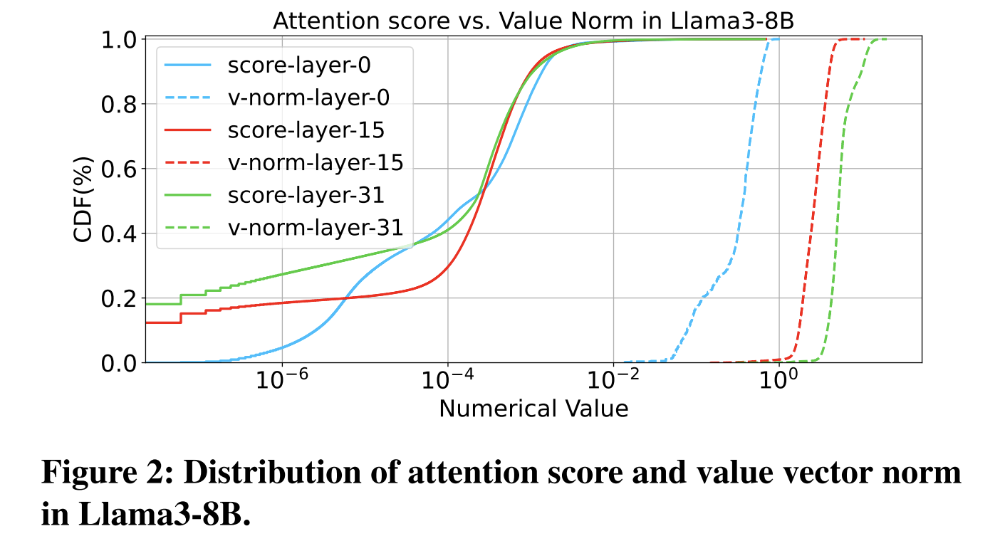
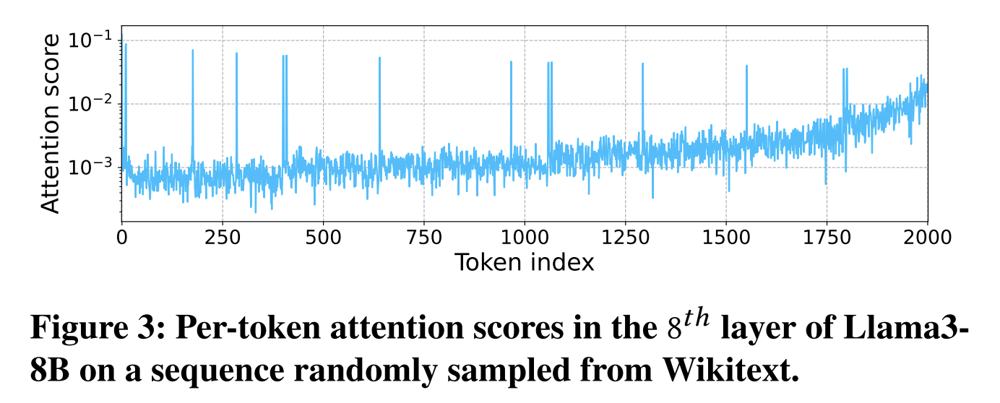
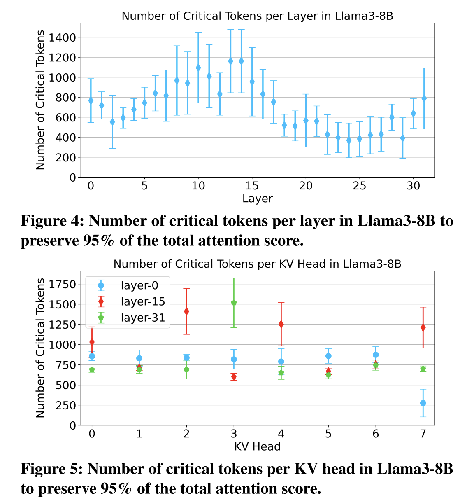
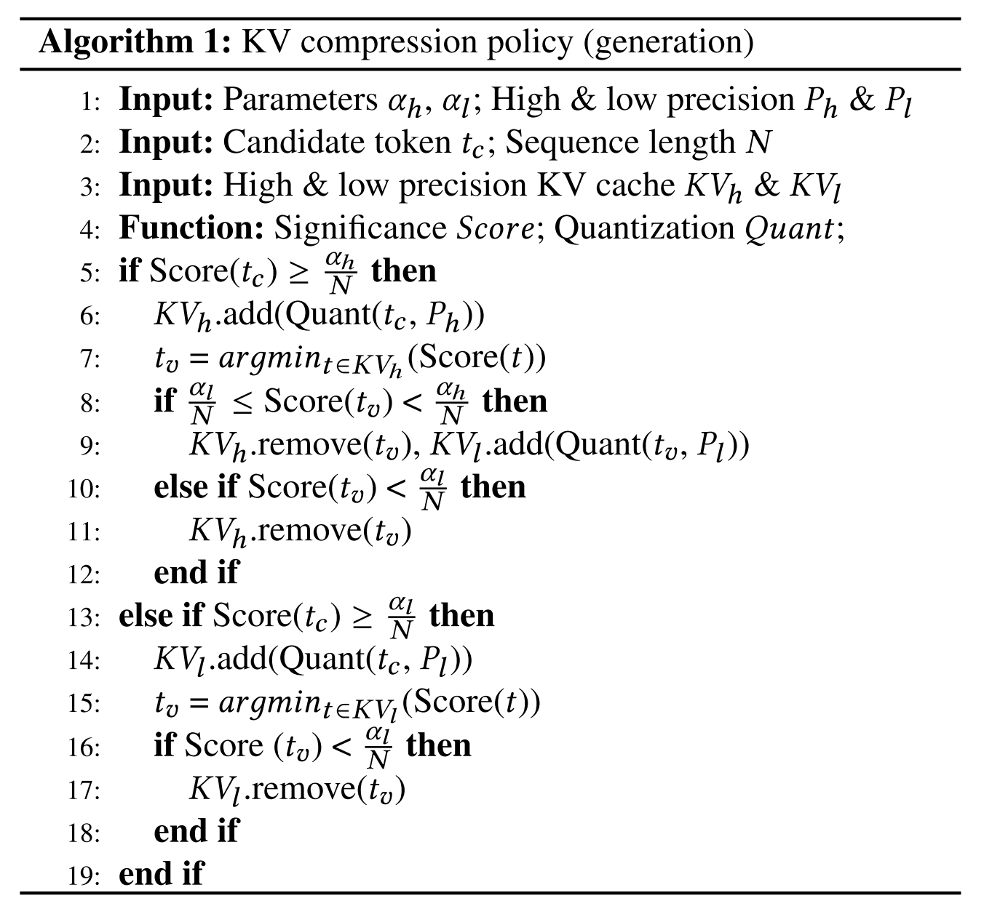
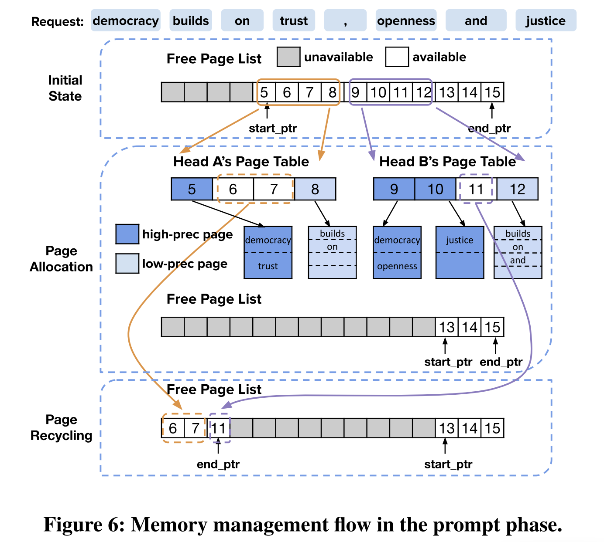
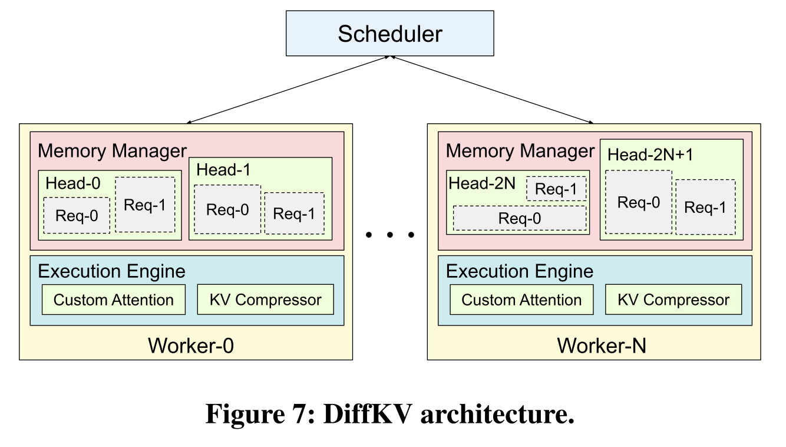

# DiffKV

**Request - Head - Attention: KV**。

过去的KV压缩技术：

* quantization（量化）：K V 相同精度，以及所有 token 相同精度。
* pruning（剪枝）：不考虑 attention 的动态稀疏性，给每个头分配相同大小内存。
* 以上两种方法，平等处理所有request，忽略了请求间信息密度的可变性。

exploits three levels of differentiation in the KV cache: 

* the differing impact of keys and values on attention computation
  * DiffKV: K的作用比V更大，分配更高精度。

* the varying importance of tokens
  * DiffKV: 根据attention score，以不同精度存储token。

* the diverse dynamic sparsity patterns across attention heads
  * DiffKV: 动态识别每个request的每个head的attention critical token，并相应调整分配内存。

challenges: These levels of differentiation introduce **irregular memory usage patterns** across different requests and attention heads, posing significant scalability challenges for memory management.

DiffKV：introduces an on-GPU memory manager via **Parallel KV compaction**, 通过把碎片内存打包成GPU上的连续区域，优化内存分配和回收。

Parallel KV compaction is enabled by three essential on-GPU data structures:

* Unified Pages
* Circular Free Page List
* Bidirectional Page Table(双向页表)

实验：

* 部署在vLLM上，在QwQ-32B, R1-Distill-Qwen-14B and R1-Distill-Llama-8B等多种thinking model上得到验证（首次）。
* 以近乎无损的精度将 KV 缓存压缩 2.7 到 5.7 倍，并将吞吐量提高 1.9 到 5.4 倍。

## The Case for Differentiated KV

### Differentiated Impacts of Keys and Values

K在做attention的时候作为softmax的一部分，影响所有token。而V只影响自身。

同时考虑到attention score的相对影响，也应该...。

K的值域范围远远比V更广，同样也说明对attention的贡献更大。

K8V4 or K4V2。

### Differentiated Token Importance

hierarchical compression strategy:

* high-precision storage (e.g., K8V4) for the most important tokens
* lower precision (e.g., K4V2) for moderately important tokens
* pruning for the least important

### Per-head Dynamic Sparsity Patterns

critical token不仅在不同head之间可能不同，在不同request的相同head下可能也不同。

* dynamic sparsity patterns across layers
* dynamic sparsity within individual layers

## KV Compression Policy

* keys at a higher precision than values: K8V4 or K4V2
* tokens: K8V4 / K4V2 / 0 
  * request-aware and sequence-length adaptive: 根据sequence len，动态调整各精度token的比例
* allows each attention head to determine its memory requirements dynamically based on its specific sparsity pattern

### Prompt Phase

per request, per head:

先做完计算，然后做KV compression。

token i 的 **significance score**，是它与后续 (N - i) 个 token 的 attention score 的平均数。

在GQA or MHA场景下，对共享同一 KV 的多个 attention head，它们对某个 KV token 的注意力分数不取平均，而是取最大值；只要有一个 head 强烈关注，该 KV token 就被视为重要。

* 为了减少过早压缩，the most recent $W$ tokens are always quantized at high precision, where $W$ is typically set to 64。
  * 保证对token i求得的significance score数值稳定，避免过早压缩。
* 对于其他的token，以自适应序列长度的方式调整精度：对比significance score 和 theoretical average $\frac{1}{i}$。
  * high precision: $\text{significant score} > \frac{\alpha_h}{i}$。
  * low precision: $\frac{\alpha_l}{i} \leqslant \text{significant score} \leqslant \frac{\alpha_h}{i}$。
  * prun:  $\text{significant score} < \frac{\alpha_l}{i}$。
  * $\alpha_l$ 和 $\alpha_h$在对calibration data做offline profiling中决定。

### Generation Phase

在每个step都压缩新生成的single token。

最近的token被添加到最近的window以防止过早压缩，而窗口中最早的token $t_c$成为压缩的候选。

压缩过程：

* $t_c$被量化为高精度/低精度，或者直接剪枝。
* 如果$t_c$被量化，考虑将KV cache的相应精度部分中的最低有效token $t_v$进一步降级：重新对比它的significance score和$\frac{\alpha_h}{N}, \frac{\alpha_l}{N}$。

## Memory Management

### Challenge

* PageAttention: Fixed page, memory waste, misaligned memory accesses(hinder memory bandwidth utilization and reduce overall computational efficiency)。
* KV Compaction Scalability: 
  * 过去memory management的时间复杂度是$O(\text{requests})$，因为给每个头分配的内存大小都是相同的。
  * 使用DIffKV的memory management，$O(\text{heads} \times \text{requests})$。

### Parallel KV Compaction

**在GPU上快速并行地动态分配和回收per-head的内存。**

两个阶段：

* planning: each attention head independently determines its memory allocation requirements.
  * 很好的可以实现并行化

* coordination: synchronizes these per-head requirements and maps them to the GPU’s physical memory.
  * 通过parallel prefix sum实现并行化

三个数据结构：

* Unified Pages
* Circular Free Page List
* Bidirectional Page Table

#### Unified Pages

将可用的GPU内存划分为大小相等的页，每个页在分配时以给定精度存储token，具体存储的token个数根据精度动态调整。

Each unified page is organized into 6 segments: 

* quantized keys
* quantization metadata for keys
* quantized values
* quantization metadata for values
* token scores
* positions

The quantization metadata: scales and zero points for the key and value vectors.

此外，把K, V, metadata都放在同一个page中，增强了数据局部性，提高内存访问效率。

#### Circular Free Page List

在连续区域中维护空闲和已用页面，通过parallel prefix sum实现**并行化分配和回收内存**。

驻留在GPU上，包含**所有page ID**，并通过**一对pointer**跟踪free page：

* a start pointer for allocations: When a page is allocated, the start pointer advances to the next available Page ID.
* an end pointer for recycling: when a page is freed, the end pointer advances to add the released Page ID back into the list.

在每个head计算了它需要allocate or free的内存之后，parallel prefix sum为每个head都计算出相对于start pointer和end pointer的offset，保证各个头的内存操作不冲突。

* memory allocation: 每个head同时获取它在free page list中分配的内存，start pointer相应移动。
* memory recycling: 每个head同时写入它在free page list中分配的page ID，end pointer随释放的page相应移动。

#### Bidirectional Page Table

**为每个head保留一份页表。**

Bidirectional: 避免为高精度和低精度页表维护产生的双份metadata overhead。

在双向页表的entry中，高精度的page ID从列表的左侧增长，而低精度的page ID从右侧增长，动态适应工作负载的精度要求。

每个page table的长度：最长序列长度 / 每个高精度page的token数量，保证不会溢出。

### KV Compaction Workflow

每次inference的时候，都会对一个batch中的所有request的所有layer进行KV compaction。

#### Prompt Phase

由于一开始对各个token的精度都未知，会假设按照所有token都是高精度来预分配页表。

A request with 8 tokens: 

#### Generation Phase

在每一个generation step，只有当要分配的高精度page或者低精度page已满的时候，才会分配新page。

每个head都会检查它的page avalability，然后通过prefix sum并行分配。

和prompt阶段不同，generation不会出现page recycling（要么因旧token被evict，存储的token数不变，要么没有eviction发生，存储的token数增加）。

当一个request完成，回收所有的page。

#### Supporting Additional Precision Levels

## Implementation

We implement DiffKV on top of vLLM, comprising 4.5K lines of CUDA/C++ code and 9K lines of Python.

### DiffKV Architecture

在每一步inference中，scheduler会在GPU容量内batches尽可能多的requests提升吞吐量，把seleted requests发往workers。

一个GPU worker包含一个memory manager用于管理分配给它的heads的内存，同时还有一个execution engine用于计算。

execution engine集成了KV compressor和定制的GPU attention kernel。

计算key and value vector $\to$ 调用KV Compressor压缩KV cache  $\to$ 调用Custom Attention kernel计算attention output。

### Efficient Attention Kernel

定制的GPU attention kernel，实现差异化的KV cache压缩，利用减少内存访问提高性能。

...

## Recap

做prefixed caching是否存在问题？

