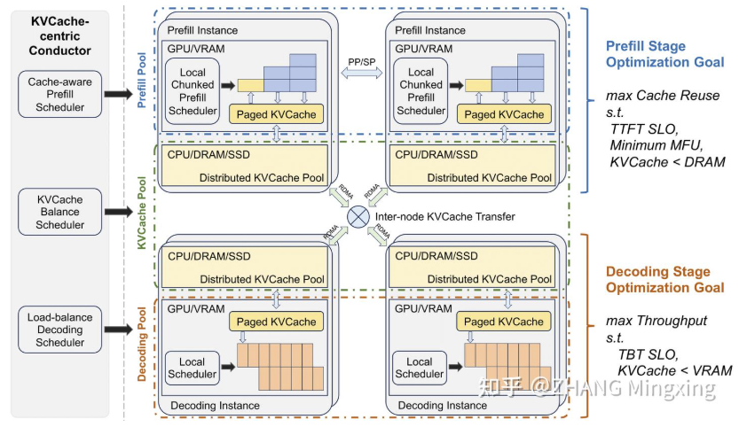
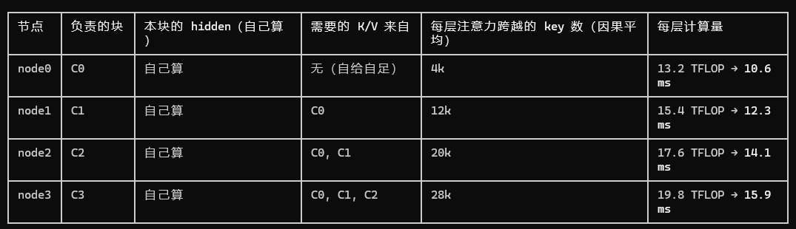
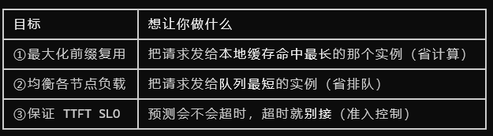
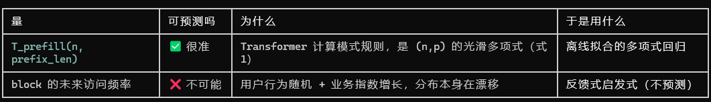
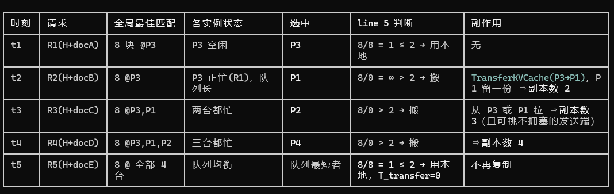
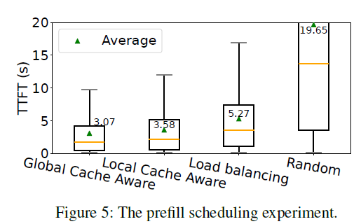

# Mooncake

在优化LLM服务的吞吐量时，通常采用两种策略：

* 尽可能重用 KVCache 以减少计算开销
  * 但是远程重用 KVCache 会延长 TTFT
* 通过增加批处理中的 token 数量提升模型的**浮点运算利用率（MFU）**
  * 而增大批处理规模则可能延长TBT

因此，同时优化吞吐量和延迟需求需要更加精细的设计。

核心流程为：全局调度器（Conductor）为每个请求选择适合的预填充和解码实例，并执行以下操作：

* 将可重用的 KVCache 传输至预填充节点；
* 以分块或分层的方式完成预填充，并将结果流式传输至解码节点；
* 加载 KVCache 并在解码节点中进行批处理以生成最终输出。

Mooncake 的设计：

* 动态预填充优化
* KVCache 感知调度
* 过载场景下的调度策略

## Prefill Pool 的实现

引入 chunked prefill 之后，是否需要 PD 分离架构成为讨论焦点。

**Mooncake 坚持 PD 分离架构**，这一选择主要基于两点考虑：

* 预填充节点需要独特的跨节点并行配置，以支持长上下文处理；
* 分解式设计为显存的优化提供了额外的空间。

仅在满足以下条件时，才将 prefill 嵌入 decode 批次：

* 请求无需分块处理；
* 不会影响解码阶段的TBT SLO。

### 跨多节点预填充的设计

处理**长上下文请求**怎么优化 TTFT？

* TP：：把每层的权重矩阵按行/列切开，在各个节点计算之后做一次 all-reduce，把部分和加起来。
  * 每层需要两次 all-reduce 操作，占用大量网络资源，降低MFU。
* SP：沿序列维把 token 切到不同节点，每个节点只算一段 token，attention 时再把 KV 交换/轮转起来。
  * SP 的收益正比于序列长度。当应用到短序列的时候，SP 的 MFU 比 TP 更低。比如 512 token 切成 4 份，每份 128 token，GEMM 变成"瘦长条"，Tensor Core 吃不满，而 all-to-all（Ulysses）或环形 KV 传递（Ring Attention）照样要做。线上流量是长短混合的 （对话 workload 平均 12k、Tool&Agent 平均 8.6k、且有大量短请求），你不可能只为长请求配一套并行策略。
  * 弹性 SP 引入架构复杂度。频繁重新分片模型状态 / 迁移 KVCache / 重组进程组。对一个跑着数千节点、日均千亿 token 的生产系统来说，这种"运行时改变并行度"的操作本身就是故障源和抖动源。

以上的方法都不行，Mooncake 设计了**分块流水线并行 CPP (Chunked Pipeline Paralism)**：

* 将预填充集群划分为多个节点组，并将输入 token 划分为长度不超过 `prefill_chunk` 的小块，CPP 实现了请求的分块并行处理。
* 与传统流水线并行类似，CPP 将通信与计算重叠，大幅提升了 MFU ，并减少了网络资源争夺。
* 在长序列和短序列场景下表现一致。

每个 node 存它负责的那一部分 chunk 的 KV cache。

### 逐层预填充的设计与优化

在每一个节点做 chunked prefill 内，通过计算与 KVCache 的加载和存储重叠，减少内存占用。

1. 每层的 KVCache 在注意力计算前完成异步加载，并同时触发下一层的加载操作；
2. 计算完成后，KVCache 的异步存储立即启动；
3. 在所有计算结束后，系统等待所有存储操作完成。

这一优化使得预填充调度无需考虑 VRAM 的整体可用容量，只需确保能够容纳单个请求的 KVCache 即可。

## 以 KVCache 为中心的调度

### Prefill 全局调度的优化设计（请求发给哪一个 node group）

传统的 LLM serving：多采用基于请求数量的负载均衡策略评估节点负载。

引入了分布式 KVCache 之后，选 prefill 实例同时要满足三个互相冲突的目标

Mooncake：**缓存感知的全局调度算法**，综合考虑了前缀缓存影响的预填充时间和队列排队时间。

`widehat(TTFT)(i) = T_transfer(i) + T_queue(i) + T_prefill(i)`，**这里先后前两者**。

**分块与哈希计算**：

- 每个新请求的输入 token 被分为若干块，对每块生成哈希键。
- 每个块的哈希键与前一个块的哈希键（若存在）进行拼接，以确保前缀缓存关系能够被准确捕捉。

**前缀匹配与时间估算**：

- 将请求的块哈希键逐一与预填充节点的缓存键比较，计算前缀匹配长度（`prefix_len`）。
- 基于请求长度和 `prefix_len`，Conductor使用预测模型**估算预填充时间**，并叠加**队列中的等待时间**以计算 TTFT。

**实例分配与反馈**：

- Conductor 将请求分配给预计 TTFT 最短的实例，同时更新该实例的缓存状态和队列时间。
- 再选一个 decode 实例 d，得到它的预计 TBT。
- 如果发现该请求无法满足 SLO，直接向客户端返回 HTTP 429 状态码，表示当前负载过高。

### 缓存负载均衡

**考虑到 T_transfer 是最难的一环**

数据量好算（transfer_len × 320 KB for LLaMA3-70B），但分母（实际可用带宽）是动态的：热点块所在的发送节点可能正被一堆并发拉取打爆。原文的结论是——正因为 T_transfer 不可靠，才需要 §4.2 的热点副本复制：把热块复制到多台机器上，让"发送节点拥塞"这件事从根上变少。这是"用机制弥补预测精度不足"的典型设计。

**问题的根源：访问频率极度倾斜**

如果热块只有一份副本，持有它的那台实例会变成双重热点：

* 计算热点：所有请求都想发给它 → 队列爆炸（T_queue 变大）
* 网络热点：所有绕路的请求都要从它拉数据 → 发送端 NIC 拥塞

 第 2 点正是 §4.1 承认 T_transfer 难预测的原因（"especially whether the sending node is under congestion"），也是§3.2.3 里那句 "In the scheduler, we mitigate congestion by increasing the number of replicas for hot KVCaches (§4.2)" 的由来。

**为什么不走"预测模型"路线**

**规则 A：绕路时顺手复制（"automated hotspot migration"）**

核心洞察：副本的产生是"路由绕路"的免费副作用，不是一个独立的运维动作。 没有后台扫描、没有热度统计、没有再平衡任务——只要有请求因为负载被绕开，热块就多了一份副本。

**规则 B：宁可重算，不要乱搬**

即 `best_len ≤ local_prefix_len × threshold` → 重算；反之才搬。

如果重算比传输更快，就去重算。

**机制为什么能"自动"收敛：一个正/负反馈循环**

沿用之前的例子，threshold = 2。

初始：系统提示 H（8 个块）只在 P3 的 DRAM 里；P1/P2/P4 都没有。

 两个关键性质：

 1. 正反馈（扩散）：越堵 → 越多请求被绕开 → 越多副本产生 → 热块的副本数自动增长到与它的访问频率成正比。
 2. 负反馈（自限）：副本越多 → 每台都能本地命中 → best_len/local = 1 → 走 else 分支 → 不再触发复制。机制会自己停下来，
    不会无限复制。

调度收益：

## 总结

* 三层解耦：计算 + 存储 + 调度

* 立场：在 chunked prefill 时代为 P/D 分离辩护
* 并行策略：CPP -- 把流水线并行从训练搬到推理
* 调度：是把三个冲突目标（缓存复用 / 负载均衡 / SLO）全部折算成"预测 TTFT"这一个量纲 + 无预测的热点自动扩散
* Transfer Engine：自研的关键技术：多 NIC 带宽聚合、拓扑感知选路（每机生成 topology matrix 广播全集群，NIC 分 preferred/secondary，避开
   UPI/PCIe Switch 瓶颈）、单请求按 16 KB 切片走不同路径、endpoint pooling + SIEVE [19] 淘汰、故障自动换路重提交。
* 社区资产：带 hash_ids 的真实 trace

