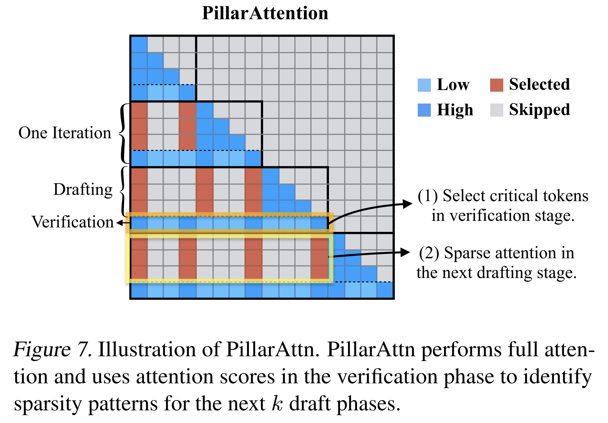
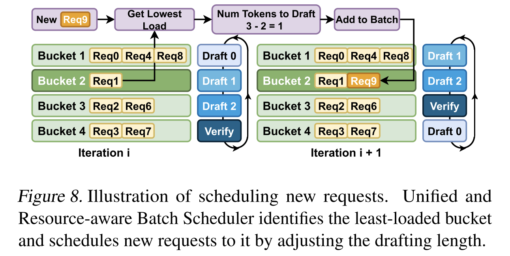
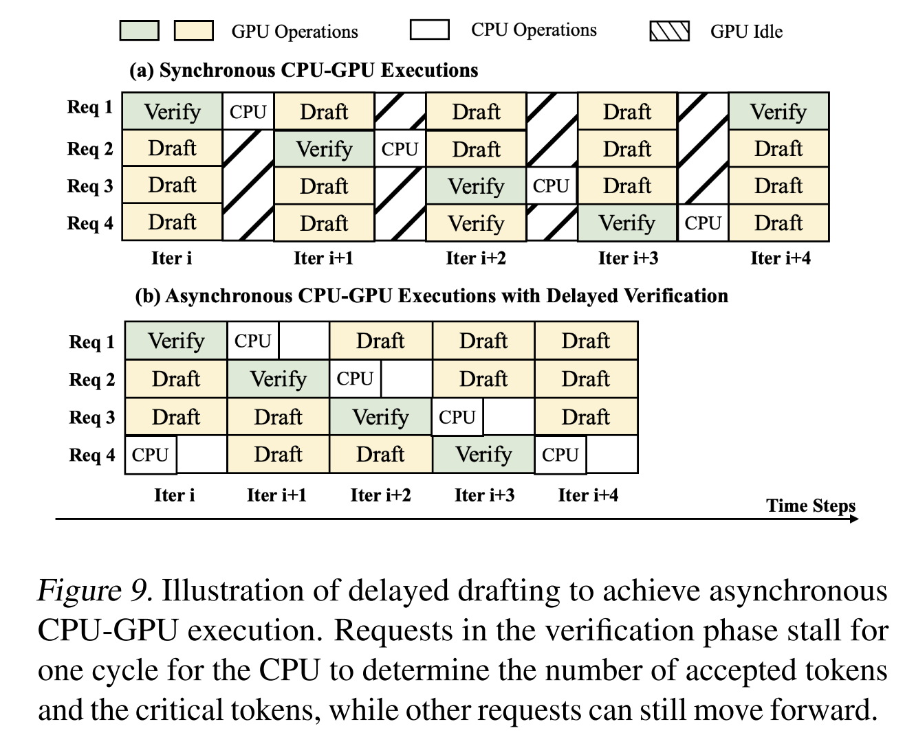

# SparseSpec

Background: self-speculative decoding + SparseAttention在 LLM inference领域的应用。

speculative decoding: 一次迭代，k次draft(sparse attention)，然后一次verify(full attention)，验证(k + 1)个token。

问题：

* existing methods provide **inaccurate drafted tokens**, due to the lack of adaptivity to the high context dynamics in RLMs.
* workload flunctuation: 在每一次迭代的draft和verify阶段，都存在workload imbalance
  * under-utilization during drafting and oversaturation during verification
* explicit synchronization: GPU需要等CPU完成verify，从而确定应该丢弃哪些token，并为下一轮更新draft status.
* KV-Cache underutilization: GPU memory waste.

Method: 

* PillarAttn: a dynamic sparse attention tailored for speculative decoding on RLMs.
* unified batch scheduler
* delayed verification
* dynamic KV-Cache manager

## PillarAttn

for each layer, each head: 

每隔 $k$ 步draft之后，PillarAttn在verification阶段做full attention时更新sparsity pattern。

verify的时候会选择Top-K attention score。

## Unified Batch Scheduler

### Uniform abstraction for draft and verification

Self-sepculative decoding的draft和verify都在相同model相同GPU下执行，只有sparse attention和full attention不同。

使用PageAttention框架，by using a page size of 1, both sparse and full attention can be unified with the same pipeline，从而简化系统设计。

### Workload-aware scheduling

解决负载不均衡的问题。

**SparseSpec evenly mixes requests from both phases in each batch (at each generation step).**

**greedy bin-packing strategy: **维护k + 1个bucket，记录verify和每个draft phase的request的数量，并把新请求分配的负载最小的draft bucket。

### Fused sparse and full attention

即使在上述理想调度下，由于attention在draft和verification的异构性，依旧存在硬件利用率低的问题。

## Delayed Verification

使用上述的unified batch scheduler之后，其实在一个batch中，只有处于验证阶段的请求需要同步，只占总batch的$\frac{1}{k + 1}$。

因此，SparseSpec不是拖延整个批处理：

Requests in the verification phase stall for one cycle for the CPU to determine the number of accepted tokens and the critical tokens, while other requests can still move forward.

## Dynamic KV-Cache Management

目标：实现更高的KV cache存储，从而避免recomputation。

SparseSpec希望提高请求并发性来充分利用KV cache。同时在接近内存不足时，将KV cache分流的到主机以避免重计算。

offload的时间开销可以忽略不计。

只要 GPU 显存一有空余，SparseSpec 会优先把之前因为显存不够而被放到 CPU 的推理请求重新调回 GPU 继续执行，而不是优先处理新来的请求。

