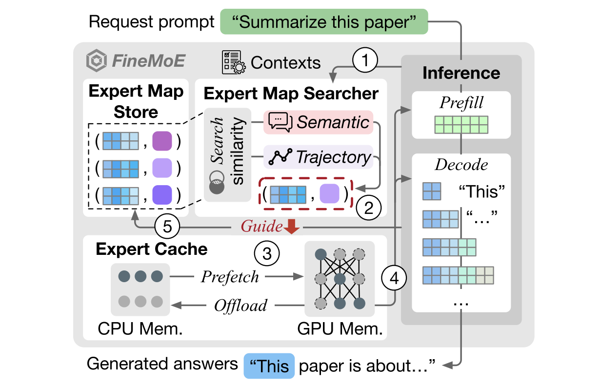
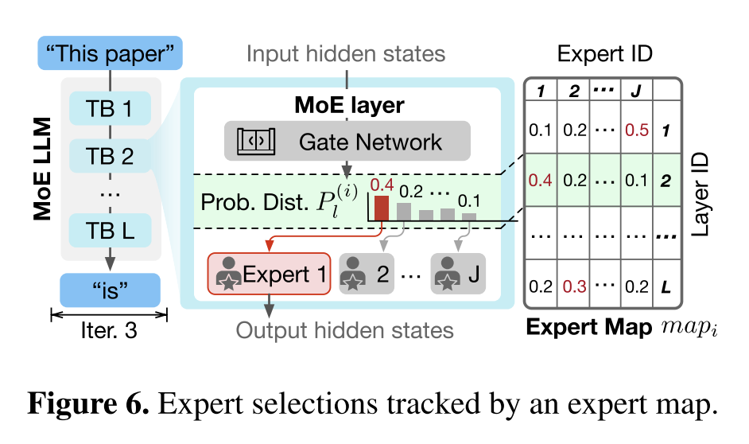
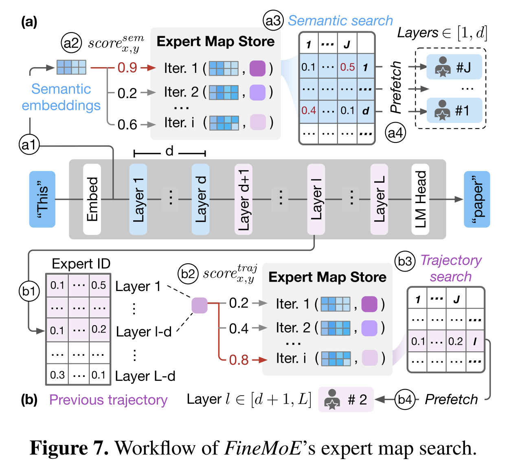
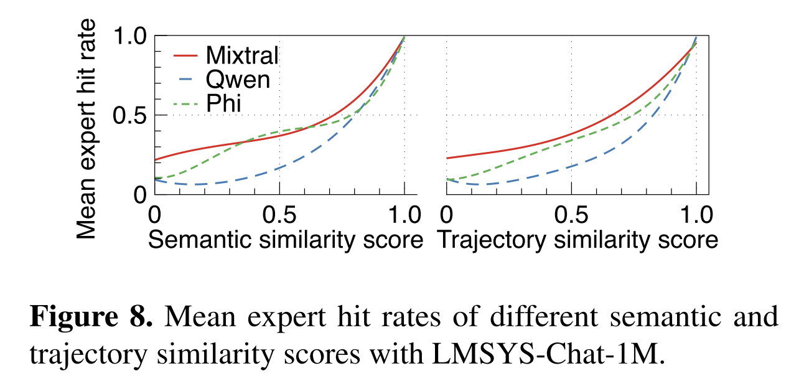
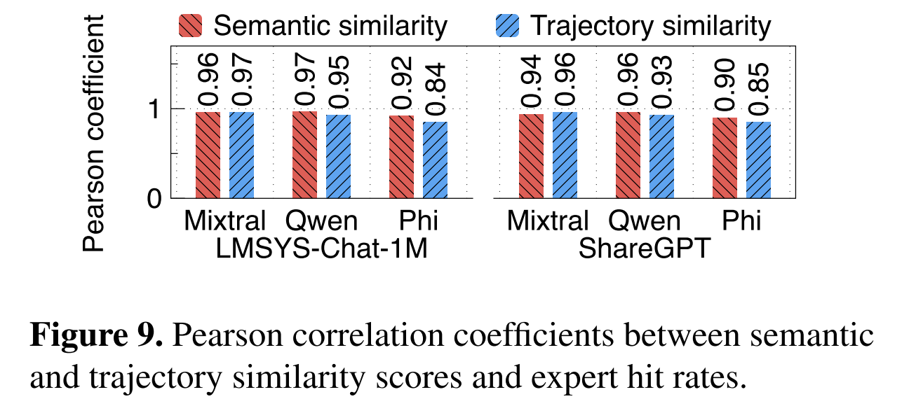
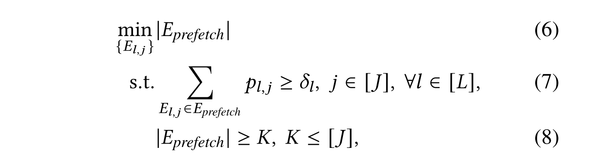

# FineMoE

Taming Latency-Memory Trade-Off in MoE-Based LLM Serving via Fine-Grained Expert Offloading.

细粒度的专家卸载方法，解决过去的latency-memory trade-off问题。

expert map: 记录历史iteration-level probability distributions outputs。

FineMoE: 在每一次iteration中，给定semantic-based和trajectory-based信息，搜出最精确的expert map，实现expert prefetching, caching, and offloading。

## Background and Motivation

粗粒度/细粒度：

* Coarse-grained information: the expert patterns collected at the request level, where information is aggregated over multiple iterations of a request prompt.
* Fine-grained information: the expert patterns observed separately during each inference iteration.

粗粒度卸载的问题：

* Insufficient latency-memory trade-off
* Low expert hit rates
* Ignorance of MoE models’ and prompts’ heterogeneity

Prefetch distance: 在某一层真正需要用到专家之前，提前多少层就开始把这些专家加载/缓存好。

## FineMoE’s Overview

* Expert Map Store: 存的是数据结构expert map，to track fine-grained expert activation patterns from historical request prompts。实时保存 the most useful and unique expert maps。
* Expert Map Searcher: 当新请求做inference之前，在Expert Map Store中，通过计算semantic and trajectory similarity，查询合适的expert map去指导做prefetch。
* Expert Cache: prefetches and offloads expert weight。

FineMoE workflow：

* **Inference context collection:** 在每次inference iteration之前，收集semantic embeddings and previous expert activation trajectories，并把它们喂到Expert Map Searcher去做hybrid similarity searching。
* **Expert map similarity searching:** 通过比较input context data和historical context data，找寻最相似的expert map。检索到的expert map被转发到Expert Cache中指导专家prefetch和offload决策。
* **Guided expert prefetching and offloading:** 根据expert map，计算expert selection thresholds，决策应该prefetch或者offload哪些专家。然后执行prefetch和offload。
* **Expert serving:** 执行本次inference iteration。如果需要的expert在GPU上直接用；否则出现expert miss，从CPU上加载。
* **Expert map update:** 每次iteration后都会产生新的expert map，将它们更新到Expert Map Store里面去。如果Expert Map Store出现冗余，那么就丢弃相应的expert map，从而最大限度地为任何请求提示提供有效的expert map。

## FineMoE’s Design

### Expert Maps

用于细粒度地记录expert activation pattern。

第$i$次迭代，第$l$层的概率分布：$\mathbf{P}_l^{(i)}:=\{p_{l,1}^{(i)},\ldots,p_{l,j}^{(i)},\ldots,p_{l,J}^{(i)}\},\quad\sum_{j\in[J]}p_{l,j}^{(i)}=1,\forall p_{l,j}^{(i)}\geq0.$

第$i$次迭代的expert map: $map_i:=\{\mathbf{P}_1^{(i)},\ldots,\mathbf{P}_l^{(i)},\ldots,\mathbf{P}_L^{(i)}\},\quad l\in[L].$

### Expert Map Search

通过 semantic similarity 和 trajectory similarity 找寻能够提供最精确专家预测的expert map。

现有方法由于依赖历史 expert 使用模式来进行预测和预取，因此在推理阶段$l \in [1, d]$无法获得足够的历史信息，从而无法提前加载对应 expert，导致 prefetch 机制在初始阶段失效。

因此，现有方法的策略：

* 前d层：prefetches the most popular experts across all historical data points.
* 即使是第d + 1到第L层：使用request-level的粗粒度metrics去做prediction和prefetching。
* 以上两种方法导致专家命中率极低。

FineMoE的做法：

* 对前d层采用Semantic-based Expert Map Search：对比input embedding和historical embedding来查找具有similar input的expert maps
* 对后续层采用Trajectory-based Expert Map Search：关注历史的专家轨迹（probability distribution），查找相似的expert maps

#### Semantic-based Expert Map Search

new semantic embedding: $sem^{\mathrm{пе}w}\in\mathbb{R}^{B\times h}$，其中B是batch size，h是hidden size。

historical semantic embedding: $sem^{old}\in\mathbb{R}^{C\times h}$，其中C是Expert Map Store capacity。

$score_{x,y}^{sem}:=\frac{sem_x^{new}\cdots em_y^{old}}{\|sem_x^{new}\|\cdot\|sem_y^{old}\|},\quad x\in[B],y\in[C]$

对于prompt $x$，选择相似性最高的历史iteration $y$ 的前 $d$ 层expert map，$\{\mathbf{P}_1^{(y)},\ldots,\mathbf{P}_d^{(y)}\}\in\text{map}_y^{old}$。

#### Trajectory-based Expert Map Search

对于第$l \in [d + 1, L]$层，使用前面$(l - d)$层的expert概率分布，匹配最优expert map。

当前prompt的前$(l - d)$层expert map: $map^{new}\in\mathbb{R}^{B\times(l-d)J}$

历史iteration的前$(l - d)$层expert map: $map^{old}\in\mathbb{R}^{C\times(l-d)J}$

$score_{x,y}^{traj}:=\frac{map_x^{new}\cdot map_y^{old}}{\|map_x^{new}\|\cdot\|map_y^{old}\|},\quad x\in[B],y\in[C]$

对于prompt $x$，选择相似性最高的历史iteration $y$的第 $l$ 层expert map，$\mathbf{P}_l^{(y)}\in\text{map}_y^{old}$。

#### Effectiveness of Semantic and Trajectory Similarity

### Expert Prefetching

给定查找到的第 $i$ 个iteration第 $l$ 层的expert map $\mathbf{P}_l^{(i)}$，如何预加载该层的expert？

相似性得分和专家命中率呈正相关。

定义expert selection threshold $\delta_l\in[0,1]$ : $\delta_l = \max(0,\min(1-score,1))$。

在$\mathbf{P}_l^i=\{p_{l,1},\ldots,p_{l,j},\ldots,p_{l,J}\}$中贪心地选择高概率的expert，直到$E_{prefetch}$的概率和超过$\delta_l$。

相似性得分越高，预加载更少的专家，减少内存占用；相似性得分越低，预加载更多的专家，减少expert misprediction。

## Expert Map Store Management

在容量为C的Expert Map Store中，需要鉴定并丢弃冗余的expert map。

pairwise redundancy scores: $RDY_{x,y}:=\frac{d}{L}\cdot score_{x,y}^{sem}+\frac{L-d}{L}\cdot score_{x,y}^{traj},x\in[B],y\in[C]$

当新iteration的context data到达expert map store，计算RDY，决定是否更换expert map。

## Expert Caching and Eviction

**Expert prefetching priority: ** $PRI_{l,j}^{prefetch}:=\frac{p_{l,j}}{l-l_{now}},\quad l\in[L],j\in[J]$

**Expert eviction priority:** $PRI_{l,j}^{e\nu ict}:=\frac{1}{p_{l,j}\cdot freq_{l,j}},\quad l\in[L],j\in[J]$

least frequently used (LFU) caching algorithm

