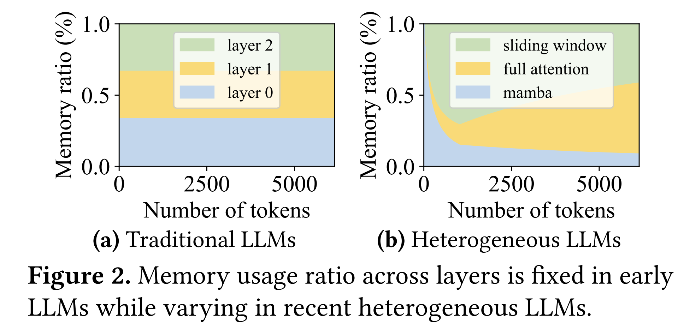

# Jenga

heterogeneity: 异质的，homogeneity: 同质的。

challenge:

* 由于不同embedding大小导致的内存碎片
* 层之间不同的attention机制引起的unpredictable memory usage

attention-property-aware allocator:

* 利用embedding大小的最小公倍数（LCM）来优化内存使用
* 基于attention模式执行cache eviction（缓存逐出）以增强memory reuse

PageAttention的两大假设：

* Fixed-size embeddings (KV cache)：内存分配的间隔连续，都是embedding size的整数倍
* Full attention：所有层都使用full attention，这意味着每个层都有一个与所有token相关联的KV缓存，并且需要相同数量的pages。
* 层与层之间的内存利用均匀。每层分配相同大小memory buffer，把每一个buffer分配成相同数量的fixed-size pages。

现如今LLM架构：heterogeneity

* heterogeneous embeddings with different sizes: VLM 的 vision embeddings for image inputs and KV cache for each token, Mamba state representing a sequence is typically larger than KV cache associated with one token.
* not all layers use the same attention mechanism: 比如 full attention 和 sliding window 交替使用，导致每层需要的pages数量不同。

在异构LLM的背景下，每层之间的内存占用差异很大，并且高度依赖request length。

Key: enabling dynamic memory exchange among different layers at runtime.

Jenga的贡献：

* 减少内存碎片：**两级内存分配**，底层LCM，高层different-size embeddings。
* 提高prefix cache命中率：
  * 为各种注意机制定制cache hit and evict策略，在各层之间保持均衡的缓存命中率。
  * common-prefix predictor, prefix cache simulator

LCM allocator和small page allocator

