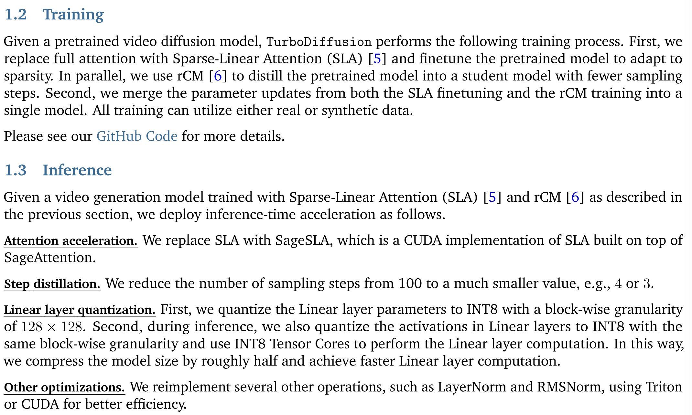

# TurboDiffusion

https://github.com/thu-ml/TurboDiffusion

加速end-to-end diffusion视频生成的一种框架：

* Attention acceleration: low-bit SageAttention（推理的时候再替换） and trainable Sparse-Linear Attention (SLA)
* Step distillation: 使用rCM（rectified Consistency Model）减少扩散采样次数
* W8A8 quantization: quantizes model parameters and activations to 8 bits for linear layer
  * the data type is INT8 and the quantization granularity is block-wise with a block size of 128 × 128.

