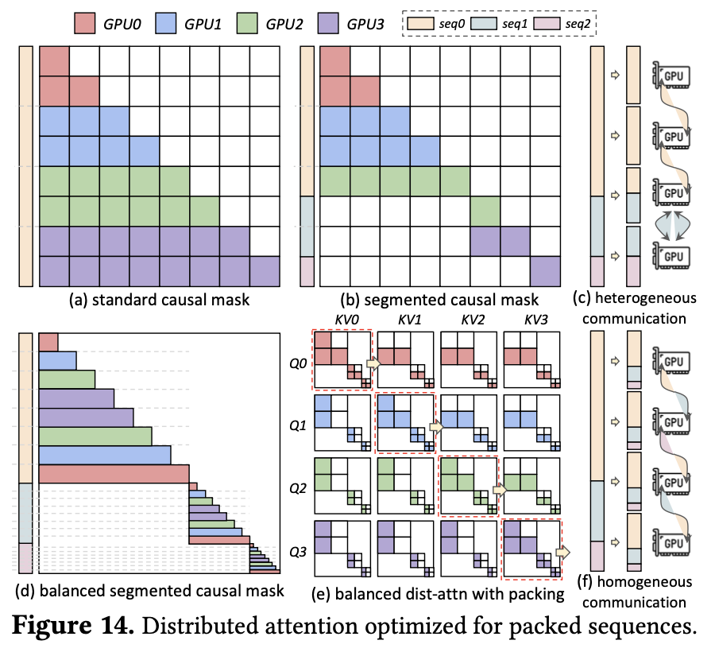
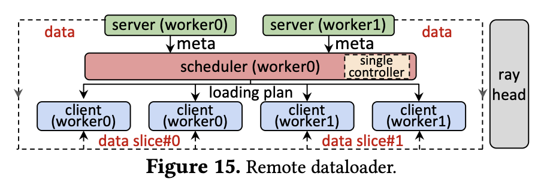
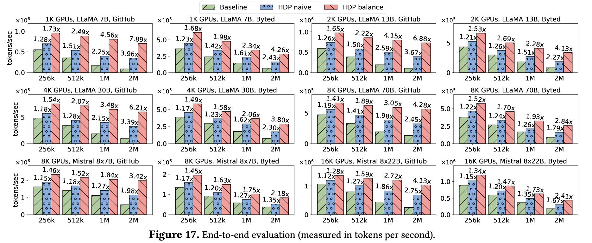
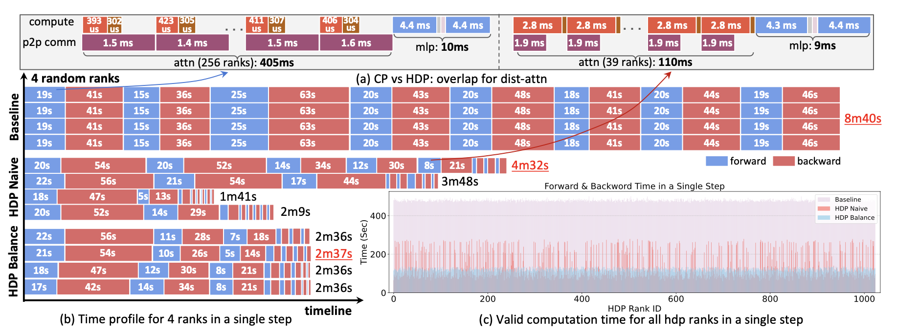
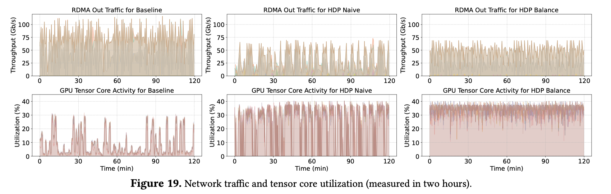
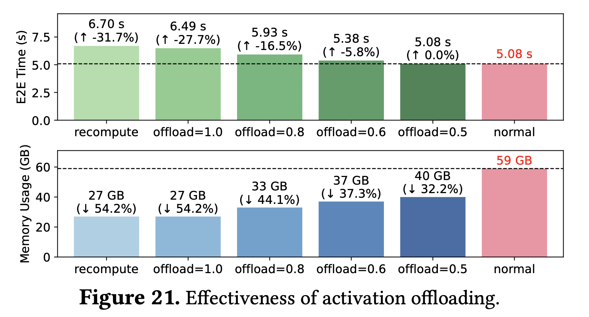

# ByteScale

$d_{\text{dp}} \times d_{\text{cp}} \times d_{\text{tp}} \times d_{\text{pp}} = N_{\text{cluster}}$

## Background

目前的问题：

1. 把DP和CP视作独立的
2. 静态的通信组网格

Challenge:

LLM序列的训练通常长度不同，数据异构性和静态DPxCP网格之间的不匹配，导致了**冗余通信**和**不平衡计算**，影响了训练效率。

* Redundant Communication: 通常的做法是将较短的序列**pack**打包到单个序列中，直到上下文长度，并配置足够的CP大小以防止内存不足(OOM)错误。然而，所有短序列必须经历与长序列相同的划分和P2P通信过程，即使这是不必要的。更糟糕的是，CP需要𝑂(𝑆2)计算来重叠𝑂(𝑆)通信，这对于短序列来说是具有挑战性的。
* Imbalanced Computation: 
  * Imbalanced FLOPs：尽管token通过CP在设备上均匀分区，并且内存是平衡的，但执行时间仍然各不相同。这是因为每个token的计算复杂性与原始序列的attention mask相关，是$O(S^2)$。计算不平衡会导致一些设备陷入空闲时间以进行gradient syncronize（DP Bubble）。
  * Imbalanced Data and Pipline Parallelism: DP Bubble, extra PP Bubble（前面较长的micro batch阻塞了后续micro batch）.

Contribution：

* core：Hybrid Data Parallelism (HDP)，将数据间/数据内分区与动态网格设计相统一，动态处理不同的序列长度。
* communication optimizer：使用**data-aware sharding**，取消了对短序列的冗余通信。自动构建动态通信组，每个序列将分别使用最少数量的设备进行处理。此外还使用**selective offloading**，压缩长序列的通信开销。
* balance scheduler（平衡调度程序）：通过**parallelism-aware data assignment**缓解计算不平衡。启发式算法，该算法根据data and pipeline parallelism的特点重新组织数据分配。
* 16384 GPUs，7-141B model size，256-2048K context length，速度快了7.89倍。

## Communication Optimizer

### Data-Aware Sharding and Communication

HDP：只需要所有rank处理相同数量的token。

Communication Optimization：global P2P communication group，构建需要额外的开销。

Optimizer States Sharding：既不切片model parameter也不切片gradients，借鉴Zero1，切片optimizer state。

Communication Optimization：类似于DP，需要用All-Reduce同步梯度，$G_{\theta_n}=\sum_{S_i\in\mathbb{B}}\left(\sum_{j\in S_i}\operatorname{grad}(j,\theta_n)\right)$。

### Data-Aware selective offloading

**Activation Offloading**: 

由于GPU内存限制，longer sequences require more HDP ranks to distribute the activation.

modern GPU servers are typically equipped with CPU memory that far exceeds GPU memory.

forward pass的时候，offload activations to the CPU, thereby reducing the required amount of ranks.

支持该方法可行的两种特征：

* Activation is first-in-last-out：当反向求梯度的时候再调回GPU的HBM。
* $O(S^2)$ computation can overlap $O(S)$ offloading：attention计算时间能够覆盖数据传输时间。

*act_ctx*：包含两个cuda线程，D2H和H2D，实现offload和reload。当卸载到CPU的时候，原computation graph中的张量由metadata{layer id, act id}代替。

**Selective Offloading：**

只有长序列的$O(S^2)$才足够大，才能实现the computation can perfectly overlap with offloading。

we must selectively offload each token based on the FLOPs.

减少长序列需要的rank数量。不仅减少了通信开销，而且让更多的HDP去处理数据。

**Overlap Efficiency Discussion**：

D2H和H2D使用DMA技术实现computation和communication重叠；pinned host memory减少CPU内存占用；PP实现D2H和H2D同步执行，最大化PCle带宽。

### Overall Routine

 ## Balance Scheduler

仔细编排数据分配，在最小化通信的同时，取消imbalance。 

### Redefine micro-batch

DP平均分配micro-batch的假设是每个batch的计算量基本相同，但现实并非如此，在此设计a more flexible strategy，不同的DP rank处理不同数量的micro batch，保证所有的DP rank同时完成计算。

### Solve PP Imbalance

Insight 1: PP bubbles are less when sequences of different length levels are assigned to separate pipelines.

If their execution times differ significantly, extra PP bubbles occur.

给执行时间少的pipeline分配更多的micro-batch

流水线的节奏由 **最慢的 micro-batch ~ 最慢的 stage** 决定。

如果某些 micro-batch 做得快，但下一批很慢：
 → 上游不能交付新的数据
 → 下游不能继续推进
 → 大量 stage 空闲

### Solve DP Imbalance

Insight 2: It is only necessary to maintain load balance at each time step when pipeline parallelism is not applied.

只有当没用PP的时候，才会考虑DP balance。

实现**负载均衡**，各个rank的FLOPs大致相等。

在同一时间，跨不同的HDP rank，分配相同长度等级的序列。

### Balance Strategy

## Implementation

### GQA

减少KV cache数量

### Dist-attn with Packing

根据seq和GPU分配情况，设计attention matrix。

### Remote Dataloader

* Server: CPU processor, fetch and preprocess raw data from HDFS and generate metadata. 
* Scheduler:  a CPU process in worker0, which collects the global metadata from all servers, deduces(推断) the loading plan, and broadcasts it to clients.
* Client: GPU processes in worker nodes,  read the partial data from servers based on the loading plan.

### Fused SoftmaxCrossEntropy

现存的大多数方法，在计算SoftmaxCrossEntropy之前，都会把数据类型BF16转换成FP32，占用很大时间和内存。

设计一个fused kernel，输入BF16，但执行的是FP32的SoftmaxCrossEntropy计算。

## Experiments

### Experiment Setup

built on MegaScale, the cluster size from 1024 GPUs to 16384 GPUs, the context length from 256K to 2M, 

global batch for each training step is fixed to 32M tokens.

Baseline:

* MegaScale with **static parallelism** strategies (DP, TP, PP and CP), along with the dist-attn optimization for packed sequences;
* MegaScale with **naive HDP**, as described in Alg. 1, which only applies communication optimizations;
* MegaScale with **balanced HDP**, as described in Alg. 2, which applies optimizations for both communication and balance.

所有的$d_{tp}$和$d_{pp}$相同，而且2、3的$d_{hdp} = d_{dp} \times d_{cp}$。

Models and Datasets: both dense and sparse LLMs

* the LLaMA-series LLMs with four different sizes, LLaMA-7B, LLaMA-13B, LLaMA-30B, and LLaMA-70B.
* Mistral-series LLMs(MoE) with two different sizes, Mistral-8x7B (active parameters = 13B/47B) and Mistral-8×22B (active parameters = 39B/141B).
* Two datasets: GitHub and Byted, 

Metrix: throughput (tokens per second) = global batch / step time

All results are averaged over 200 iterations after a 20-iteration warmup.

### End-to-End Evaluation

Difference in Scalability：

* 随着context length长度增加，不得不把一些短序列pack到长序列，然后使用dist-attention，造成低效率和冗余通信。
* 但是naive HDP和balanced HDP下降的速度更慢。

Difference in Datasets：

* Byted数据集的长序列比GitHub更多，总的吞吐量更低。

Difference in Parallelism Strategies：

* HDP with DP-Balance achieves shown in Figure 18(b), although the third rank completes a higher speedup, compared to the PP-Balance.

### Case Study

Byted数据集，LLAMA-7B模型，2M context length。

* static parallelism：micro batch = 8，$d_{cp} = 256$，实现能够跑2M长度的seq。属于Communication-Bound，P2P通信花的时间更长。
* HDP naive：通信量减少，计算花的时间比通信更长，但是存在同步等待，属于Computation-Imbalance Case。
* Balance Case：all ranks finish execution nearly at the same time.each rank is assigned micro-batches with similar FLOPs, ranks with shorter execution times (e.g. the third and fourth ranks) will be assigned more, batches.

### Ablation Study

**Effectiveness of Dynamic Communication / Balance Strategy:** 

RDMA traffic和tensor core utilization

**Effectiveness of Selective Offloading: **

As the context length is set to 64K, the computation cannot fully overlap with offloading. However, as we reduce the ratio to 𝑟 = 0.5, it can save 32.3% of memory without compromising throughput. 

as the context length increases, a higher ratio can be set to save more memory (e.g. set 𝑟 = 1.0 for 256K will not decrease throughput).

**Effectiveness of Remote Dataloader.**

improves the speedup from $3.69 \times$ to $3.89 \times$.

